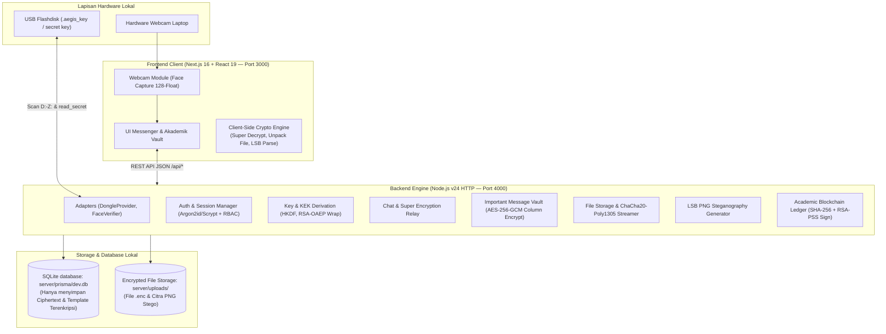
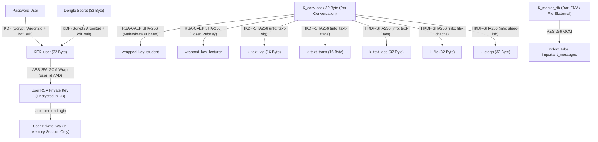
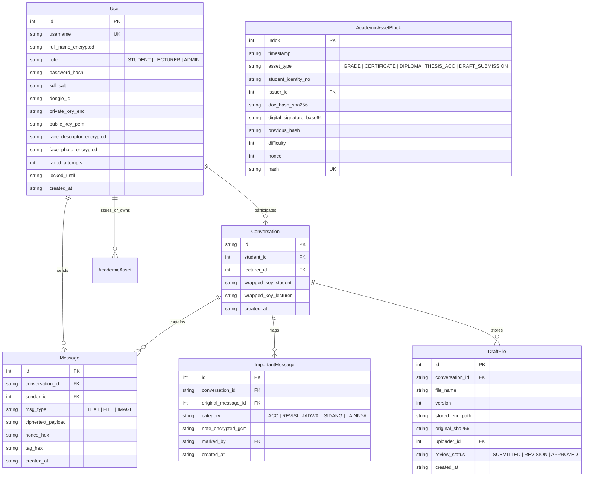

# Dokumen Arsitektur Teknis: SkripsiChat
*(Messenger Akademik Dosen-Mahasiswa Terenkripsi — Tugas Akhir Kriptografi)*

Dokumen ini mendokumentasikan topologi sistem, hierarki kunci kriptografi, skema database, dan diagram aliran data sesuai spesifikasi [SkripsiChat_Spesifikasi.md](./SkripsiChat_Spesifikasi.md).

---

## 1. Topologi Sistem & Pemisahan Tanggung Jawab

---

## 2. Hierarki Kunci Kriptografi (Key Hierarchy)

Sesuai Bagian 7 spesifikasi:

---

## 3. Protokol Kriptografi per Fitur

| Fitur / Modul | Kebutuhan Kriptografi | Algoritma & Formula | Alasan Desain |
|---|---|---|---|
| **Pilar 1: Login & Akses** | Hashing Password + Dongle Gate + Biometrik | Scrypt / Argon2id (`salt` 16B), AES-256-CBC token di dongle, Euclidean Distance (`< 0.48`) pada 128-float facial vector. | Kunci privat tidak bisa didekripsi tanpa fisik dongle dan password yang benar. |
| **Pilar 2A: Chat Teks** | Super Enkripsi (2 Klasik + 1 Modern) | $P \rightarrow \text{Vigenère (Mod 256)} \rightarrow \text{Transposisi Kolom 16-kolom} \rightarrow \text{AES-256-GCM (12B Nonce + 16B Tag)}$. | Menjamin kerahasiaan (*confidentiality*) dan keaslian (*integrity/authenticity*) pesan bimbingan. |
| **Pilar 2B: Draf Skripsi** | Enkripsi Berkas (Berbeda dari Teks) | **ChaCha20-Poly1305** (RFC 8439) per streaming chunk + SHA-256 integritas. | Pemenuhan syarat algoritma berbeda (stream cipher modern bertenaga tinggi). |
| **Pilar 3A: Pesan Penting** | Database-at-Rest Column Encryption | **AES-256-GCM** dengan `K_master_db` yang tersimpan di luar DB. | Database administrator tidak bisa membaca catatan penting (ACC/Revisi) secara telanjang. |
| **Pilar 3B: Foto Dokumen** | Steganografi Citra Digital | **LSB (Least Significant Bit)** 3-Kanal (RGB) pada PNG Lossless, payload terenkripsi AES-GCM + metrik PSNR (> 50 dB) & MSE. | Menyembunyikan catatan persetujuan di dalam foto lembar pengesahan tanpa merusak kualitas visual. |
| **Pilar 4: Aset Akademik** | Blockchain & Anti-Tampering | SHA-256 hash chaining, Proof-of-Work (`difficulty 00...`), digital signature **RSA-PSS (SHA-256)** oleh Dosen penerbit. | Menjamin dokumen nilai, sertifikat, dan surat ACC tidak dapat dipalsukan atau dimanipulasi. |

---

## 4. Skema Database Relasional (SQLite: `server/prisma/dev.db`)

---

## 5. Konvensi Format Data & Encoding
* **Format Waktu**: ISO-8601 UTC (`YYYY-MM-DDTHH:mm:ss.sssZ`).
* **Format Kunci Asimetris**: RSA-2048 SPKI (Public Key PEM) & PKCS#8 (Private Key Encrypted PEM).
* **Format Ciphertext Super Enkripsi**: `SKRIPSI-SUPER-V1:<iv_hex>:<tag_hex>:<ciphertext_hex>`.
* **Format File Terenkripsi**: Biner `.enc` dengan header 12-byte Nonce + 16-byte Poly1305 Tag + ciphertext byte stream.
* **Canonical JSON**: Key JSON selalu diurutkan alfabetis tanpa whitespace untuk memastikan kesamaan hash signature blockchain.
