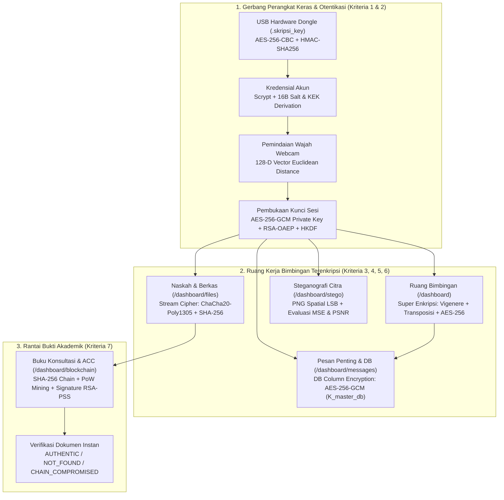

# Pemetaan Kriteria Penilaian Tugas Akhir — SkripsiChat

Dokumen ini memetakan bagaimana ketujuh kriteria penilaian Tugas Akhir Kriptografi dipenuhi secara menyeluruh di dalam arsitektur **SkripsiChat** (*Academic Advisory & Thesis Encryption Platform*), mulai dari lapisan perangkat keras, otentikasi, komunikasi pesan bimbingan, penyimpanan basis data, hingga rantai blok aset akademik.

---

## 1. Tabel Utama Pemenuhan 7 Kriteria Penilaian

| No | Kriteria Penilaian Tugas Akhir | Dipenuhi Dengan Cara (Mekanisme & Algoritma) | Alur pada Aplikasi SkripsiChat | Modul & Lokasi Kode Utama | Skenario Pembuktian Saat Sidang |
| :-: | :--- | :--- | :--- | :--- | :--- |
| **1** | **Aplikasi memiliki fungsi login biometrik dan hanya dapat dihidupkan menggunakan bantuan dongle** | **1. Hardware USB Dongle Gatekeeper:** File kunci `.skripsi_key` berisi payload identitas yang dienkripsi **AES-256-CBC** dan dilindungi tanda tangan **HMAC-SHA256**. **2. Runtime Lockout Guard:** Polling status dongle aktif selama sesi; jika dongle dicabut, UI otomatis terkunci. **3. Biometrik Wajah:** Ekstraksi vektor fitur wajah **128-dimensi (`Float32`)** via Webcam Canvas yang dicocokkan menggunakan **Euclidean Distance** ($d \le 0.45$). | 1. Pengguna mencolokkan USB Dongle (atau mengaktifkan Dongle di Server Console `:4000`). 2. Di halaman Login Step 2, sistem memvalidasi kepemilikan dongle milik username terkait. 3. Pengguna memindai wajah lewat kamera. 4. Jika dongle dicabut saat di Dashboard, layar langsung mengunci akses. | **Server:** [1_dongleKey.ts](file:///D:/dev/webdev/project/kriptografi/SkripsiChat/server/src/crypto/1_dongleKey.ts), [dongle.adapter.ts](file:///D:/dev/webdev/project/kriptografi/SkripsiChat/server/src/adapters/dongle.adapter.ts), [face.adapter.ts](file:///D:/dev/webdev/project/kriptografi/SkripsiChat/server/src/adapters/face.adapter.ts) **Client:** [LoginPage.tsx](file:///D:/dev/webdev/project/kriptografi/SkripsiChat/client/src/features/login/LoginPage.tsx), [useDongleStatus.ts](file:///D:/dev/webdev/project/kriptografi/SkripsiChat/client/src/features/login/hooks/useDongleStatus.ts) | - Matikan dongle di Server Console -> tombol Login terkunci & Dashboard otomatis tertutup layar kunci. - Pindai wajah orang berbeda -> ditolak karena jarak Euclidean $> 0.45$. |
| **2** | **Login aplikasi menggunakan algoritma kriptografi (hash, AES, KDF, asimetris)** | **1. Password Hashing:** **Scrypt KDF** (`N=16384, r=8, p=1`, 64-byte hash) + **16-byte CSPRNG Salt** unik per akun + verifikasi *constant-time* (`timingSafeEqual`). **2. Key Wrapping & KEK:** Kombinasi `password` + `dongle_secret` diturunkan menjadi **KEK (256-bit)** untuk membuka **Private Key RSA-2048** yang terenkripsi **AES-256-GCM**, lalu membuka kunci percakapan via **RSA-OAEP SHA-256** & **HKDF-SHA256**. | 1. Pengguna memasukkan username & password pada Step 1. 2. Server memverifikasi hash Scrypt dan menurunkan KEK bersama rahasia dongle. 3. Private key pengguna dibuka di memori untuk mendekripsi kunci percakapan bimbingan. | **Server:** [1_passwordHash.ts](file:///D:/dev/webdev/project/kriptografi/SkripsiChat/server/src/crypto/1_passwordHash.ts), [keys.service.ts](file:///D:/dev/webdev/project/kriptografi/SkripsiChat/server/src/services/keys.service.ts), [auth.service.ts](file:///D:/dev/webdev/project/kriptografi/SkripsiChat/server/src/services/auth.service.ts) **Client:** [Step1CredentialForm.tsx](file:///D:/dev/webdev/project/kriptografi/SkripsiChat/client/src/features/login/forms/Step1CredentialForm.tsx) | - Tunjukkan hash Scrypt + Salt pada tabel `User` (tidak pernah menyimpan password plaintext). - Uji salah password 1 karakter -> verifikasi Scrypt & pembukaan AES-GCM Private Key gagal. |
| **3** | **Pesan teks dienkripsi menggunakan super enkripsi (algoritma modern dan klasik)** | **Pipeline Super Enkripsi 3-Lapis Berurutan:** 1. *Klasik Substitusi*: **Extended Vigenère Cipher** (geseran byte modulo 256 dengan sub-kunci `k_text_vig`). 2. *Klasik Permutasi / Stream*: **Columnar Transposition Cipher** terindeks Fisher-Yates (`k_text_trans`) / **Vernam XOR**. 3. *Modern AEAD*: **AES-256-GCM** (96-bit Nonce + 128-bit AuthTag + AAD pengikat konteks percakapan) / **AES-256-CBC**. | 1. Mahasiswa/Dosen mengetik pesan diskusi skripsi di **Ruang Bimbingan (`/dashboard`)** lalu menekan **Kirim**. 2. Pesan otomatis melewati 3 tahap enkripsi sebelum disimpan ke tabel `SecretMessage`. 3. Saat percakapan dibuka, pesan didekripsi balik (AES -> Transposisi -> Vigenère) dan dilengkapi *Inspector Ciphertext* per tahap. | **Server:** [2_superEncryption.ts](file:///D:/dev/webdev/project/kriptografi/SkripsiChat/server/src/crypto/2_superEncryption.ts), [chat.service.ts](file:///D:/dev/webdev/project/kriptografi/SkripsiChat/server/src/services/chat.service.ts), [message.service.ts](file:///D:/dev/webdev/project/kriptografi/SkripsiChat/server/src/services/message.service.ts) **Client:** [DashboardWorkspace.tsx](file:///D:/dev/webdev/project/kriptografi/SkripsiChat/client/src/features/dashboard/components/DashboardWorkspace.tsx), [ChatStream.tsx](file:///D:/dev/webdev/project/kriptografi/SkripsiChat/client/src/features/dashboard/components/ChatStream.tsx) | - Kirim pesan di Ruang Bimbingan. - Klik ikon detail kriptografi pada gelembung pesan untuk melihat hasil ciphertext Lapis 1 (Vigenère), Lapis 2 (Transposisi/Vernam), dan Lapis 3 (AES-256). |
| **4** | **Pesan file dienkripsi menggunakan kriptografi yang beda dari teks** | **Stream Cipher Modern RFC 8439:** Menggunakan **ChaCha20-Poly1305** (256-bit key, 96-bit nonce unik, 128-bit Poly1305 MAC AuthTag) — **100% berbeda** dari algoritma teks (Vigenère + Transposisi + AES) — ditambah verifikasi keutuhan berkas asli dengan **SHA-256**. | 1. Mahasiswa mengunggah draf skripsi (`.docx`/`.pdf`) di menu **Naskah & Berkas (`/dashboard/files`)** atau via tombol lampiran chat. 2. Server mengenkripsi biner berkas menjadi `.enc` dengan ChaCha20-Poly1305. 3. Dosen mengunduh & mendekripsi berkas serta memberi status review (`REVISION` / `APPROVED`). | **Server:** [2_fileChaCha20.ts](file:///D:/dev/webdev/project/kriptografi/SkripsiChat/server/src/crypto/2_fileChaCha20.ts), [file.service.ts](file:///D:/dev/webdev/project/kriptografi/SkripsiChat/server/src/services/file.service.ts) **Client:** [FilesView.tsx](file:///D:/dev/webdev/project/kriptografi/SkripsiChat/client/src/features/files/components/FilesView.tsx) | - Unggah file PDF/DOCX, buka folder `server/uploads/*.enc` untuk membuktikan file tidak bisa dibuka aplikasi pembaca dokumen. - Unduh lewat aplikasi dengan passphrase benar -> file kembali utuh sesuai hash SHA-256. |
| **5** | **Pesan penting dienkripsi pada basis data yang digunakan** | **Database-at-Rest Column Encryption:** Setiap pesan penting (Keputusan ACC, Revisi Mayor, Jadwal Sidang) pada tabel `ImportantMessage` serta kolom sensitif tabel `User` dienkripsi per kolom di SQLite menggunakan **AES-256-GCM** dengan kunci master server **`K_master_db`** (disimpan terpisah di luar DB) dan pengikatan konteks **AAD** (`important_messages.content|<id>`). | 1. Dosen/Pengguna menandai pesan krusial melalui tombol **Catat Penting** di chat atau di menu **Pesan Penting (`/dashboard/messages`)**. 2. SQLite hanya menyimpan nilai hex terenkripsi (`contentEnc`, `nonceHex`, `authTagHex`). 3. Tab **Inspeksi Basis Data** menampilkan perbandingan *Raw SQLite Ciphertext* vs *Plaintext Terdekripsi*. | **Server:** [3_dbEncryption.ts](file:///D:/dev/webdev/project/kriptografi/SkripsiChat/server/src/crypto/3_dbEncryption.ts), [vault.service.ts](file:///D:/dev/webdev/project/kriptografi/SkripsiChat/server/src/services/vault.service.ts) **Client:** [MessagesView.tsx](file:///D:/dev/webdev/project/kriptografi/SkripsiChat/client/src/features/messages/components/MessagesView.tsx), [DbInspectorView.tsx](file:///D:/dev/webdev/project/kriptografi/SkripsiChat/client/src/features/db-inspector/components/DbInspectorView.tsx) | - Tandai satu pesan bimbingan sebagai `ACC` atau `JADWAL_SIDANG`. - Buka tab **Inspeksi DB** -> perlihatkan kolom mentah SQLite berisi ciphertext acak AES-GCM, sedangkan di tampilan aplikasi terbaca jelas. |
| **6** | **Pesan gambar diamankan menggunakan konsep steganografi** | **Spatial Domain LSB Steganography (Lossless PNG):** Menyisipkan pesan/catatan rahasia (terproteksi kunci XOR/AES-GCM + header `AEGISLSB` + 32-bit payload length) ke dalam bit paling tidak berarti (**Least Significant Bit**) kanal piksel R, G, dan B pada citra PNG tanpa kompresi *lossy*, lengkap dengan perhitungan metrik **MSE** dan **PSNR (dB)**. | 1. Pengguna membuka **Steganografi Citra (`/dashboard/stego`)** atau klik ikon gambar pada chat. 2. Pilih gambar PNG diagram/bukti bimbingan dan ketik catatan tersembunyi. 3. Sistem menghasilkan citra stego PNG (PSNR $> 50\text{ dB}$) yang tampil normal di chat namun dapat diekstrak kembali pesannya dengan passkey. | **Server:** [3_steganography.ts](file:///D:/dev/webdev/project/kriptografi/SkripsiChat/server/src/crypto/3_steganography.ts), [stego.service.ts](file:///D:/dev/webdev/project/kriptografi/SkripsiChat/server/src/services/stego.service.ts) **Client:** [StegoView.tsx](file:///D:/dev/webdev/project/kriptografi/SkripsiChat/client/src/features/stego/components/StegoView.tsx) | - Sisipkan catatan rahasia ke gambar PNG -> tunjukkan nilai MSE mendekati `0.000x` dan PSNR $> 50\text{ dB}$ (identik secara kasat mata). - Ekstrak gambar tersebut untuk memunculkan pesan rahasianya. |
| **7** | **Aset penting diamankan menggunakan teknologi blockchain sederhana** | **Hash-Linked Ledger + PoW + Digital Signature:** 1. Rantai hash **SHA-256** (`previousHash` mengikat blok sebelumnya sejak Genesis Block `#0`). 2. **Proof-of-Work (PoW Mining)** mencari `nonce` hingga hash blok diawali target nol. 3. **Tanda Tangan Digital RSA-PSS SHA-256** penerbit (Dosen) atas JSON kanonik aset (`THESIS_ACC`, `GRADE`, `CERTIFICATE`, `DIPLOMA`). | 1. Dosen menerbitkan Surat ACC Sidang / Nilai di menu **Buku Konsultasi & ACC (`/dashboard/blockchain`)**. 2. Sistem menandatangani hash dokumen PDF/DOCX dengan RSA-PSS dan menambang blok baru. 3. Siapa pun dapat mengunggah dokumen ke fitur **Verifikasi Dokumen** untuk mengecek keaslian (`AUTHENTIC` / `NOT_FOUND` / `CHAIN_COMPROMISED`). | **Server:** [4_blockchain.ts](file:///D:/dev/webdev/project/kriptografi/SkripsiChat/server/src/crypto/4_blockchain.ts), [chain.service.ts](file:///D:/dev/webdev/project/kriptografi/SkripsiChat/server/src/services/chain.service.ts), [blockchain.service.ts](file:///D:/dev/webdev/project/kriptografi/SkripsiChat/server/src/services/blockchain.service.ts) **Client:** [BlockchainView.tsx](file:///D:/dev/webdev/project/kriptografi/SkripsiChat/client/src/features/blockchain/components/BlockchainView.tsx) | - Terbitkan Surat ACC -> unggah file asli (hasil: `ASLI / AUTHENTIC`). - Ubah 1 karakter isi file -> unggah ulang (hasil: `TIDAK COCOK / NOT_FOUND`). - Klik **Simulasi Tamper Blok** -> rantai terdeteksi merah (`CHAIN_COMPROMISED`). |

---

## 2. Diagram Alur Keseluruhan Aplikasi SkripsiChat

---

## 3. Checklist Kesiapan Sidang & Kriteria Tugas Akhir

- [ ] **Checklist 1 (Dongle & Biometrik):** Aplikasi menolak login dan mengunci layar Dashboard secara otomatis apabila Hardware Dongle tidak terpasang, serta mewajibkan kecocokan wajah melalui kamera.
- [ ] **Checklist 2 (Kriptografi Login):** Password di-hash dengan Scrypt + Salt acak, serta penurunan kunci sesi menggabungkan rahasia dongle + password (KEK) dan pembungkusan kunci RSA-OAEP.
- [ ] **Checklist 3 (Super Enkripsi Teks):** Percakapan teks di Ruang Bimbingan mengenkripsi pesan secara otomatis menggunakan gabungan algoritma klasik (Extended Vigenère + Transposisi/Vernam) dan modern (AES-256) serta dapat diinspeksi per tahap.
- [ ] **Checklist 4 (Enkripsi File Berbeda):** Berkas draf skripsi dienkripsi menggunakan ChaCha20-Poly1305 (berbeda penuh dari algoritma enkripsi teks) dan mendukung status review Dosen Pembimbing.
- [ ] **Checklist 5 (Enkripsi Pesan Penting di DB):** Keputusan penting (ACC, Revisi, Jadwal Sidang) terenkripsi AES-256-GCM pada kolom tabel SQLite dengan kunci master terpisah dan dibuktikan lewat tampilan *Raw DB Inspector*.
- [ ] **Checklist 6 (Steganografi Gambar):** Gambar PNG bimbingan dapat disisipi catatan tersembunyi dengan metode LSB, menampilkan skor PSNR & MSE, dan dapat diekstrak kembali.
- [ ] **Checklist 7 (Blockchain Aset Penting):** Surat ACC, Nilai, dan jejak audit tercatat dalam blok berantai SHA-256 dengan Proof-of-Work, tanda tangan digital RSA-PSS Dosen, fitur verifikasi keaslian dokumen, serta simulasi deteksi manipulasi (*tamper detection*).
