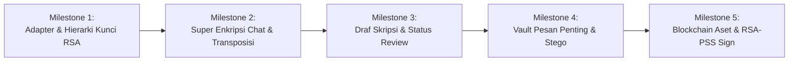

# Implementation & Refactoring Plan: **SkripsiChat**
*(Transisi dari AegisVault ke Messenger Bimbingan Skripsi Dosen-Mahasiswa)*

Dokumen ini adalah **Rencana Kerja & Roadmap Implementasi** bertahap untuk merefactor dan mengembangkan fitur `SkripsiChat` dengan memanfaatkan kode existing yang sudah berjalan (*Dongle & Face Recognition*), sesuai spesifikasi [SkripsiChat_Spesifikasi.md](./SkripsiChat_Spesifikasi.md).

---

## 1. Ringkasan Perubahan Konseptual (AegisVault -> SkripsiChat)

| Elemen Sistem | AegisVault (Investigasi - Existing) | SkripsiChat (Messenger Akademik - Target) |
|---|---|---|
| **Tema & Alur** | Brankas Whistleblower & Investigator | Aplikasi Bimbingan Skripsi (Mahasiswa & Dosen) |
| **Aktor Pengguna** | Investigator, Chief Auditor | **Mahasiswa** (`STUDENT`), **Dosen** (`LECTURER`), **Admin** (`ADMIN`) |
| **Pilar 1 (Auth)** | USB Dongle `.aegis_key` + Face + Password Scrypt | Dipertahankan 100% via Adapter `DongleProvider` & `FaceVerifier` + Keypair Unlock |
| **Pilar 2A (Pesan)** | Vigenère + Vernam + AES-256-CBC | **Vigenère + Transposisi Kolom + AES-256-GCM** (Session Conversation Key) |
| **Pilar 2B (File)** | ChaCha20-Poly1305 Dokumen Bukti | **ChaCha20-Poly1305 Draf Skripsi/Tugas** (PDF/DOCX ber-versi + Status Review) |
| **Pilar 3A (DB Vault)** | Enkripsi kolom mentah di SQLite | **Pesan Penting Terenkripsi** (Pemberian ACC, Revisi, Jadwal Sidang via `K_master_db`) |
| **Pilar 3B (Stego)** | Foto Bukti Lapangan LSB PNG | **Foto/Scan Dokumen Bimbingan LSB PNG** (Menyisipkan catatan lembar pengesahan terenkripsi) |
| **Pilar 4 (Chain)** | Audit Log Transaksi SHA-256 | **Blockchain Aset Akademik** (Nilai, Sertifikat, Ijazah, Surat ACC dengan Tanda Tangan Digital RSA-PSS Dosen) |

---

## 2. Fase Implementasi Bertahap (Roadmap 5 Milestone)

---

### Milestone 1: Adapter Layer & Key Management (Hierarki Kunci RSA & HKDF)
* **Tujuan**: Membungkus modul login existing agar memenuhi kontrak interface Bagian 2.3 dan membangun fondasi keypair per user.
* **Perubahan Kode**:
  1. `[NEW] server/src/adapters/dongle.adapter.ts` — Mengimplementasikan interface `DongleProvider` (`is_present()`, `get_id()`, `read_secret()`, `write_secret()`) membungkus `1_dongleKey.ts`.
  2. `[NEW] server/src/adapters/face.adapter.ts` — Mengimplementasikan interface `FaceVerifier` (`enroll()`, `verify()`) membungkus `1_passwordHash.ts` & `biometric.ts`.
  3. `[NEW] server/src/crypto/keys.ts` (`FR-KEY-01..04`):
     - `generateUserKeypair()` -> RSA-2048 (SPKI public key, PKCS#8 private key).
     - `deriveKek(password, dongleSecret, kdfSalt)` -> KEK 32-byte.
     - `protectPrivateKey(privateKey, kek, userId)` -> enkripsi AES-256-GCM private key untuk disimpan di DB.
     - `unlockPrivateKey(user, password, dongleSecret)` -> dekripsi private key ke memori saat login.
     - `createConversationKey()` & `wrapKey()` / `unwrapKey()` -> pembungkusan kunci percakapan RSA-OAEP.
     - `deriveSubkeys(kConv)` -> HKDF-SHA256 untuk subkey `text-vig` (16B), `text-trans` (16B), `text-aes` (32B), `file-chacha` (32B), `stego-lsb` (32B).
* **Verifikasi**: Unit test `keys.test.ts` berhasil membungkus dan membuka kunci percakapan antara Dosen dan Mahasiswa.

---

### Milestone 2: Modul Super Enkripsi Chat (Vigenère + Transposisi + AES-GCM)
* **Tujuan**: Memenuhi `FR-CHAT-01..05` dengan kombinasi cipher klasik dan modern sesuai spesifikasi Bagian 11.3.
* **Perubahan Kode**:
  1. `[NEW] server/src/crypto/classic.ts`:
     - `vigenereEncrypt(data, key)` / `vigenereDecrypt(data, key)` (Modulo 256 pada byte stream).
     - `permFromKey(key16)` -> Permutasi kolom deterministik 0..15 menggunakan Fisher-Yates shuffle berbasis counter hash.
     - `transpositionEncrypt(data, perm)` / `transpositionDecrypt(data, perm)` -> Transposisi kolom 16-jalur dengan padding aman.
  2. `[NEW] server/src/crypto/superChatCrypto.ts`:
     - `superEncryptChatMessage(plaintext, subkeys, aad)`:
       - Prefix 4-byte panjang pesan (`uint32_be`).
       - Vigenère encrypt (`k_text_vig`).
       - Transposisi kolom encrypt (`k_text_trans`).
       - AES-256-GCM encrypt (`k_text_aes`) dengan AAD `conv_id || sender_id`.
     - `superDecryptChatMessage(encryptedBlob, subkeys, aad)`: urutan kebalikannya.
  3. `[NEW] server/src/routes/chat.routes.ts`:
     - Endpoint list conversations, send message, fetch messages.
* **Verifikasi**: Uji pesan teks dengan karakter Indonesia, simbol, dan emoji; verifikasi bahwa manipulasi 1 byte pada ciphertext ditolak oleh tag GCM (`ERR_DECRYPT_FAILED`).

---

### Milestone 3: Draf Skripsi & File Berkas (ChaCha20-Poly1305 Streaming)
* **Tujuan**: Memenuhi `FR-FILE-01..06` untuk pengiriman file skripsi/tugas (PDF/DOCX) dengan versi bertingkat dan review status.
* **Perubahan Kode**:
  1. `[MODIFY] server/src/routes/file.routes.ts` -> `files.routes.ts`:
     - Validasi ekstensi (`.pdf`, `.docx`) dan pengecekan magic bytes header file (`%PDF-`, `PK\x03\x04`).
     - Enkripsi streaming chunk 1 MiB menggunakan **ChaCha20-Poly1305** dengan `k_file`.
     - Penomoran versi otomatis jika mengunggah file revisi dengan nama yang sama.
     - Endpoint dosen untuk mengubah status review draf: `SUBMITTED` -> `REVISION` / `APPROVED` disertai catatan revisi.
* **Verifikasi**: File PDF skripsi terenkripsi utuh, dekripsi mengembalikan file identik dengan SHA-256 awal yang sama.

---

### Milestone 4: Vault Pesan Penting (Column Encryption) & Steganografi LSB Foto
* **Tujuan**: Memenuhi `FR-VAULT-01..04` dan `FR-IMG-01..05`.
* **Perubahan Kode**:
  1. `[NEW] server/src/routes/vault.routes.ts`:
     - Fitur bintang ⭐ oleh Dosen untuk menandai pesan bimbingan penting: kategori `ACC`, `REVISI`, `JADWAL_SIDANG`.
     - Enkripsi kolom database menggunakan **AES-256-GCM** dengan `K_master_db`.
  2. `[EXTEND] server/src/routes/stego.routes.ts`:
     - Konversi otomatis foto lembar pengesahan/dokumen ke **PNG Lossless**.
     - Penyisipan payload metadata (`conv_id`, `sender_id`, `note`, `sha256`) yang dienkripsi AES-GCM ke dalam LSB kanal RGB.
     - Perhitungan dan penampilan nilai metrik PSNR (> 50 dB) dan MSE di UI.
* **Verifikasi**: Pesan penting terbaca di vault hanya dengan master key; pesan stego pada foto lembar pengesahan dapat diekstrak kembali dengan sempurna.

---

### Milestone 5: Blockchain Aset Akademik & Tanda Tangan Digital (RSA-PSS)
* **Tujuan**: Memenuhi `FR-CHAIN-01..08` untuk validasi keaslian nilai, sertifikat, draf, dan surat persetujuan (ACC).
* **Perubahan Kode**:
  1. `[EXTEND] server/src/crypto/4_blockchain.ts` -> `chain.ts`:
     - Struktur blok canonical JSON: `index`, `timestamp`, `data`, `signer_id`, `signature`, `prev_hash`, `difficulty`, `nonce`, `hash`.
     - Tipe aset akademik: `GRADE`, `CERTIFICATE`, `DIPLOMA`, `THESIS_ACC`, `DRAFT_SUBMISSION`.
     - Tanda tangan digital penerbit menggunakan **RSA-PSS dengan SHA-256** menggunakan private key dosen.
     - Proof of Work dengan `CHAIN_DIFFICULTY` (default `00`).
  2. `[NEW] server/src/routes/chain.routes.ts`:
     - Endpoint penerbitan aset oleh Dosen.
     - Endpoint verifikasi dokumen publik: pengguna mengunggah file dokumen asli, sistem mencocokkan SHA-256 ke blockchain dan memverifikasi tanda tangan digital dosen (Output: **ASLI**, **TIDAK COCOK**, atau **CHAIN TERMANIPULASI**).
* **Verifikasi**: Pengujian verifikasi dokumen asli berhasil; perubahan 1 byte pada file dokumen atau modifikasi data blok langsung terdeteksi invalid.

---

## 3. Pembagian Tugas 2 Orang (Teamwork Allocation)

* **👤 Anggota 1 (Spesialis Backend, Auth & Blockchain)**:
  - Memegang modul `adapters/`, `keys/`, `vault/`, dan `chain/`.
  - Fokus pada alur login (Dongle + Wajah), penerbitan aset akademik oleh dosen, tanda tangan RSA-PSS, dan validasi blockchain.
* **👤 Anggota 2 (Spesialis Kriptografi Konten, Chat & Steganografi)**:
  - Memegang modul `crypto/classic/`, `superChatCrypto.ts`, `files/`, dan `stego/`.
  - Fokus pada Super Enkripsi Vigenère+Transposisi+AES-GCM, streaming file ChaCha20 draf skripsi, dan steganografi foto PNG.

---

## 4. Rencana Pengujian (Test Matrix)

| Test Suite | File Lokasi | Target Pengujian |
|---|---|---|
| **Auth & Dongle** | `server/src/test/auth.test.ts` | Startup gate dongle, lockout 5x percobaan, KEK derivation, pembukaan private key. |
| **Super Enkripsi Chat** | `server/src/test/chat.test.ts` | Vigenère byte-wise, transposisi kolom, AES-GCM AAD matching, tampering detection. |
| **File ChaCha20** | `server/src/test/files.test.ts` | Enkripsi file PDF chunking, integritas SHA-256, kenaikan versi draf. |
| **Stego LSB** | `server/src/test/stego.test.ts` | Kapasitas bit, PSNR > 50 dB, ekstraksi payload terenkripsi dari PNG. |
| **Blockchain Akademik**| `server/src/test/chain.test.ts` | PoW mining, verifikasi tanda tangan RSA-PSS dosen, verifikasi keaslian dokumen upload. |
