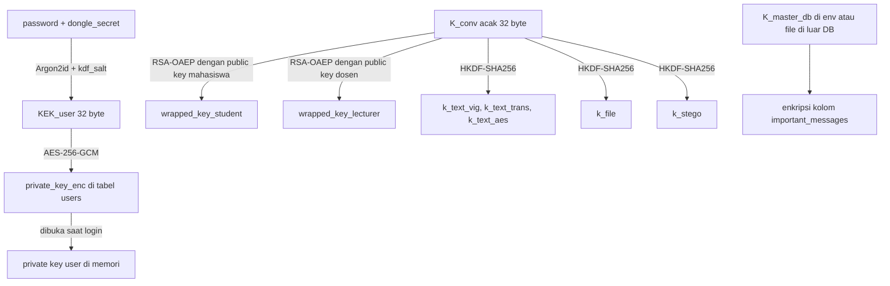
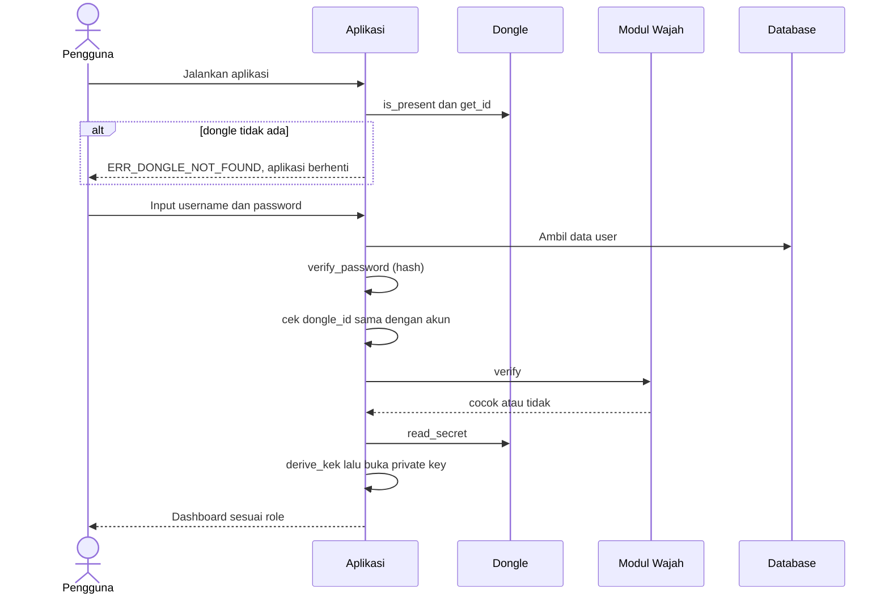
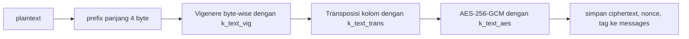
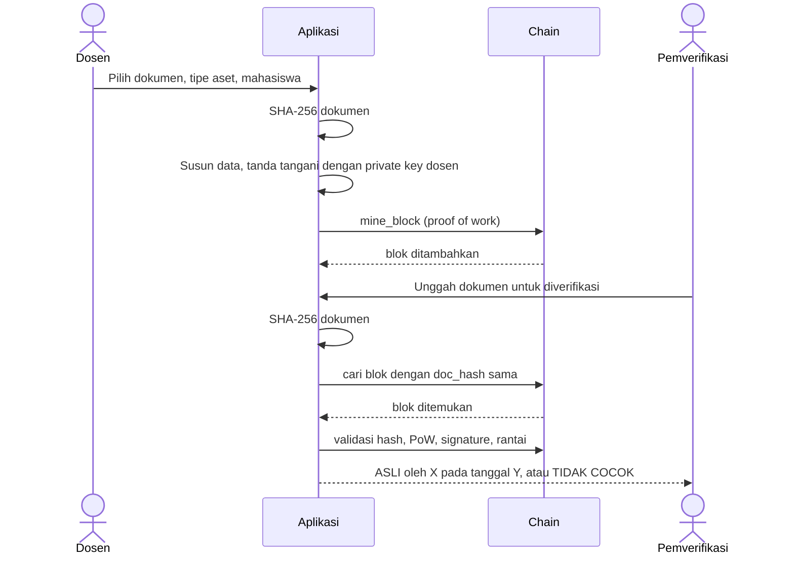

# SkripsiChat: Spesifikasi Sistem dan Konteks Pengembangan

| Atribut | Isi |
|---|---|
| Nama proyek | SkripsiChat (messenger akademik dosen-mahasiswa) |
| Mata kuliah | Kriptografi, Tugas Akhir |
| Versi dokumen | 1.0 |
| Tanggal | 2026-11-06 |
| Pembaca utama | AI coding agent (Antigravity) dan anggota tim |
| Tujuan dokumen | Konteks untuk **pengembangan fitur baru** dan **refactor** kode yang sudah ada |

---

## Daftar Isi

- [0. Cara Menggunakan Dokumen Ini](#0-cara-menggunakan-dokumen-ini)
- [1. Ringkasan Proyek](#1-ringkasan-proyek)
- [2. Kondisi Saat Ini dan Aturan Integrasi](#2-kondisi-saat-ini-dan-aturan-integrasi)
- [3. Arsitektur dan Struktur Modul](#3-arsitektur-dan-struktur-modul)
- [4. Pemetaan Kriteria Tugas Akhir](#4-pemetaan-kriteria-tugas-akhir)
- [5. Aktor dan Hak Akses](#5-aktor-dan-hak-akses)
- [6. Konvensi Teknis](#6-konvensi-teknis)
- [7. Hierarki Kunci](#7-hierarki-kunci)
- [8. Alur Sistem](#8-alur-sistem)
  - [8.1 Startup dan Login](#81-startup-dan-login)
  - [8.2 Registrasi User oleh Admin](#82-registrasi-user-oleh-admin)
  - [8.3 Kirim dan Baca Pesan Teks](#83-kirim-dan-baca-pesan-teks)
  - [8.4 Upload dan Download File](#84-upload-dan-download-file)
  - [8.5 Kirim dan Buka Foto Dokumen](#85-kirim-dan-buka-foto-dokumen)
  - [8.6 Pesan Penting](#86-pesan-penting)
  - [8.7 Terbitkan Aset dan Verifikasi](#87-terbitkan-aset-dan-verifikasi)
- [9. Functional Requirements](#9-functional-requirements)
- [10. User Actions](#10-user-actions)
- [11. Logika Fungsi per Modul](#11-logika-fungsi-per-modul)
  - [11.1 Modul AUTH](#111-modul-auth)
  - [11.2 Modul KEYS](#112-modul-keys)
  - [11.3 Modul CRYPTO](#113-modul-crypto)
  - [11.4 Modul CHAT](#114-modul-chat)
  - [11.5 Modul VAULT](#115-modul-vault)
  - [11.6 Modul FILES](#116-modul-files)
  - [11.7 Modul STEGO](#117-modul-stego)
  - [11.8 Modul CHAIN](#118-modul-chain)
  - [11.9 Modul ADMIN](#119-modul-admin)
  - [11.10 Modul AUDIT](#1110-modul-audit)
- [12. Model Data](#12-model-data)
- [13. Kode Error](#13-kode-error)
- [14. Non-Functional Requirements dan Aturan Keamanan](#14-non-functional-requirements-dan-aturan-keamanan)
- [15. Kriteria Penerimaan dan Pengujian](#15-kriteria-penerimaan-dan-pengujian)
- [16. Roadmap Implementasi](#16-roadmap-implementasi)
- [17. Asumsi Terbuka dan Decision Log](#17-asumsi-terbuka-dan-decision-log)

---

## 0. Cara Menggunakan Dokumen Ini

Bagian ini adalah **aturan kerja untuk AI agent**. Baca sebelum menyentuh kode.

### 0.1 Aturan wajib

1. **Inventaris kode dulu.** Sebelum menulis kode, pindai repo: deteksi bahasa, framework, struktur folder, library kripto yang sudah dipakai, dan lokasi kode login dongle serta scan wajah. Hasilnya dicatat di bagian [2.2](#22-inventaris-kode-existing-diisi-agent).
2. **Kode login yang sudah jalan adalah aset yang dilindungi.** Jangan ditulis ulang. Bungkus dengan adapter (lihat [2.3](#23-kontrak-adapter)). Perubahan perilaku hanya boleh jika diminta eksplisit oleh pengguna.
3. **Dokumen ini bersifat language-agnostic.** Signature fungsi seperti `chat.send_text_message(session, conv_id, plaintext) -> Message` adalah panduan. Sesuaikan penamaan dengan konvensi bahasa di repo (snake_case, camelCase, PascalCase).
4. **Prioritas:** `MUST` harus selesai, `SHOULD` dikerjakan jika waktu cukup, `COULD` opsional.
5. **Traceability.** Sebut ID requirement (contoh `FR-CHAT-02`) di komentar kode, nama test, dan pesan commit.
6. **Tiap fungsi baru wajib punya unit test**: minimal satu happy path dan satu failure path.
7. **Jangan menambah fitur di luar dokumen** tanpa mencatatnya di [Decision Log](#173-decision-log).
8. **Jika dokumen bertentangan dengan kode existing yang sudah berjalan**, kode existing menang. Catat selisihnya di Decision Log dan lanjutkan.
9. **Jangan mengimplementasi primitif kripto modern sendiri** (AES, ChaCha20, SHA, RSA, Argon2, HKDF). Pakai library standar. Hanya cipher klasik (Vigenère dan transposisi) yang ditulis manual karena memang syarat tugas.

### 0.2 Cara memakai untuk refactor

1. Buat tabel pemetaan "fungsi existing → modul target" di [2.2](#22-inventaris-kode-existing-diisi-agent).
2. Refactor bertahap: satu modul per langkah, test tetap hijau di setiap langkah.
3. Pertahankan public interface existing selama masih dipakai pemanggil lain. Jika harus berubah, sediakan fungsi pembungkus lama yang memanggil fungsi baru.

### 0.3 Contoh perintah ke agent

- "Baca `SkripsiChat_Spesifikasi.md`. Kerjakan bagian 2.2 (inventaris kode), jangan ubah kode apa pun dulu."
- "Implementasikan modul KEYS sesuai bagian 11.2 dan requirement FR-KEY-*. Sertakan unit test."
- "Refactor kode login existing agar memenuhi kontrak adapter di bagian 2.3, tanpa mengubah perilaku."

---

## 1. Ringkasan Proyek

**SkripsiChat** adalah aplikasi messenger untuk bimbingan skripsi antara mahasiswa dan dosen pembimbing. Seluruh data sensitif (pesan, file, gambar, aset akademik) dilindungi dengan kombinasi algoritma kriptografi sesuai kriteria Tugas Akhir mata kuliah Kriptografi.

Prinsip desain:

- **Enkripsi di sisi klien.** Database dan storage hanya melihat ciphertext.
- **Dongle dan wajah terhubung ke manajemen kunci**, bukan hanya jadi pintu masuk. Tanpa dongle, private key tidak bisa dibuka.
- **Satu fitur, satu mekanisme kriptografi yang jelas**, supaya mudah dijelaskan di laporan.

Fitur utama:

| Fitur | Ringkasan |
|---|---|
| Chat bimbingan | Pesan teks dengan super enkripsi (klasik + modern) |
| Draf skripsi dan tugas | File PDF/DOCX terenkripsi dengan algoritma berbeda dari teks |
| Foto atau scan dokumen | Steganografi LSB pada PNG, berisi catatan dan metadata terenkripsi |
| Pesan penting | Pesan ACC, revisi, jadwal sidang disimpan terenkripsi per kolom di database |
| Aset akademik | Nilai, sertifikat, ijazah, dan ACC dicatat di blockchain sederhana |

---

## 2. Kondisi Saat Ini dan Aturan Integrasi

### 2.1 Status

| Komponen | Status | Catatan |
|---|---|---|
| Login dengan dongle | **Sudah jadi** | Jangan ditulis ulang |
| Scan wajah (biometrik) | **Sudah jadi** | Jangan ditulis ulang |
| Manajemen kunci, chat, file, stego, blockchain, database terintegrasi | **Belum ada** | Dibangun sesuai dokumen ini |
| Bahasa dan framework | **Belum diketahui oleh dokumen ini** | Agent mendeteksi dari repo |

### 2.2 Inventaris kode existing (diisi agent)

Agent mengisi tabel ini sebelum memulai pekerjaan lain.

| Pertanyaan | Jawaban (isi) |
|---|---|
| Bahasa dan versi | |
| Framework UI | |
| Library kripto yang sudah dipakai | |
| Database yang sudah dipakai (jika ada) | |
| File dan fungsi pengecekan dongle | |
| Apa yang bisa dilakukan dongle? (hanya baca serial, baca file kunci, atau bisa sign/HMAC) | |
| File dan fungsi scan wajah (enroll dan verify) | |
| Di mana template wajah disimpan, dan apakah terenkripsi | |
| Alur startup saat ini | |

Pemetaan fungsi existing ke modul target:

| Fungsi existing | Lokasi | Modul target | Tindakan (WRAP / MOVE / KEEP) |
|---|---|---|---|
| | | | |

### 2.3 Kontrak adapter

Agar modul baru tidak bergantung pada detail implementasi login yang sudah ada, definisikan dua interface tipis. Implementasinya membungkus kode existing.

```
interface DongleProvider
    is_present() -> bool
    get_id() -> string                      # serial atau identifier unik dongle
    read_secret() -> bytes[32]              # secret yang tersimpan di dongle
    write_secret(secret: bytes[32]) -> void # hanya dipakai saat registrasi (admin.provision_user)
    sign_challenge(nonce: bytes) -> bytes   # OPSIONAL, jika dongle mendukung

interface FaceVerifier
    enroll(user_id) -> template_ref         # dipakai saat registrasi
    verify(user_id) -> bool                 # membuka kamera, membandingkan dengan template
```

Aturan:

- Modul `auth` hanya boleh bicara ke dongle dan wajah lewat dua interface ini.
- **Jika dongle existing tidak bisa menyimpan atau membaca secret** (misalnya hanya membaca serial number), gunakan salah satu fallback berikut, lalu catat pilihan di Decision Log:
  - (a) file kunci 32 byte di flashdisk dongle, dibaca sebagai `read_secret()`;
  - (b) turunkan secret dari `serial + salt rahasia aplikasi` (lebih lemah, hanya untuk demo).

### 2.4 Titik refactor yang perlu dicek

Agent memeriksa dan melaporkan (tanpa langsung mengubah) hal-hal berikut jika ditemukan:

- Template wajah disimpan sebagai plaintext. **Rekomendasi:** enkripsi kolom dengan `crypto.column_encrypt` memakai master key.
- Password disimpan dengan hash lemah (MD5, SHA-1, SHA-256 tanpa salt). **Rekomendasi:** migrasi ke Argon2id dengan rehash saat login berikutnya.
- Kunci atau secret hardcoded di source code. **Rekomendasi:** pindah ke environment atau file di luar repo.
- Pengecekan dongle hanya dilakukan sekali saat startup. **Rekomendasi:** cek berkala (lihat FR-AUTH-07).

---

## 3. Arsitektur dan Struktur Modul

### 3.1 Gambaran lapisan

```
UI (desktop/web/mobile sesuai repo)
   │
Service layer: auth, chat, vault, files, stego, chain, admin
   │
Core layer:    keys, crypto (classic, aead, hashing, signature), audit
   │
Storage layer: repository database + penyimpanan file terenkripsi
   │
Adapter:       DongleProvider, FaceVerifier  (membungkus kode existing)
```

Aturan ketergantungan: lapisan atas boleh memanggil lapisan bawah, tidak sebaliknya. `crypto` tidak boleh mengimpor `chat`, `files`, dan sejenisnya.

### 3.2 Saran struktur folder

Sesuaikan dengan konvensi repo. Jika sudah ada struktur, petakan, jangan dibongkar tanpa alasan.

```
app/
├── adapters/        # DongleProvider, FaceVerifier (bungkus kode existing)
├── auth/            # login, session, password, role check
├── keys/            # keypair, KDF, wrap/unwrap, subkey, master key
├── crypto/
│   ├── classic/     # vigenere, transposition
│   ├── aead/        # aes_gcm, chacha20_poly1305, column encryption
│   ├── hashing/     # sha256, password hash
│   └── signature/   # sign, verify
├── chat/
├── vault/           # pesan penting terenkripsi di DB
├── files/
├── stego/
├── chain/
├── admin/
├── audit/
├── storage/         # repository DB, penyimpanan file terenkripsi
├── config/          # konstanta dan konfigurasi
└── ui/
tests/
docs/
```

### 3.3 Mode deployment (asumsi awal)

Aplikasi desktop klien yang terhubung ke satu database bersama (atau server ringan). Pengiriman dan penerimaan dilakukan lewat tabel `messages` (pull atau polling). Seluruh enkripsi dan dekripsi terjadi di klien. Jika repo sudah memakai arsitektur lain, pertahankan prinsip "server hanya melihat ciphertext" dan catat di Decision Log.

---

## 4. Pemetaan Kriteria Tugas Akhir

| No | Kriteria di slide | Fitur di SkripsiChat | Algoritma | Modul | Requirement |
|---|---|---|---|---|---|
| 1 | Login biometrik dan hanya bisa dihidupkan dengan dongle | Startup gate dongle, login password, verifikasi wajah | Dongle check, face match | `auth`, `adapters` | FR-AUTH-01, 03, 04 |
| 2 | Login memakai algoritma kriptografi (hash, JCrypto, AES, dll) | Hash password, pembukaan private key | Argon2id (atau bcrypt), AES-256-GCM, HKDF | `auth`, `keys` | FR-AUTH-02, 05 |
| 3 | Pesan teks dienkripsi dengan super enkripsi (modern dan klasik) | Pesan bimbingan | Vigenère → Transposisi → AES-256-GCM | `crypto`, `chat` | FR-CHAT-02, 03 |
| 4 | File dienkripsi dengan kripto yang beda dari teks | Draf skripsi, tugas | ChaCha20-Poly1305 per chunk | `crypto`, `files` | FR-FILE-02 |
| 5 | Pesan penting dienkripsi di database | Pesan ACC, revisi, jadwal sidang | AES-256-GCM per kolom, master key di luar DB | `vault` | FR-VAULT-02 |
| 6 | Pesan gambar diamankan dengan steganografi | Foto atau scan dokumen | LSB pada PNG, payload dienkripsi AES-GCM | `stego` | FR-IMG-01 s.d. 04 |
| 7 | Aset penting diamankan dengan blockchain sederhana | Nilai, sertifikat, ijazah, ACC | SHA-256, proof of work, tanda tangan RSA-PSS | `chain` | FR-CHAIN-01 s.d. 08 |

---

## 5. Aktor dan Hak Akses

| Aktor | Deskripsi | Catatan |
|---|---|---|
| **Mahasiswa** (`STUDENT`) | Peserta bimbingan | Terhubung ke satu atau lebih dosen pembimbing lewat percakapan |
| **Dosen** (`LECTURER`) | Pembimbing | Menerbitkan aset akademik dan mereview draf |
| **Admin** (`ADMIN`) | Pengelola sistem | Boleh digabung dengan dosen atau di-seed manual jika waktu terbatas |

Matriks hak akses:

| Aksi | Mahasiswa | Dosen | Admin |
|---|:-:|:-:|:-:|
| Login (dongle + password + wajah) | ✔ | ✔ | ✔ |
| Lihat percakapan miliknya | ✔ | ✔ | ✘ |
| Kirim dan baca pesan teks | ✔ | ✔ | ✘ |
| Upload dan download file di percakapannya | ✔ | ✔ | ✘ |
| Ubah status review file | ✘ | ✔ | ✘ |
| Kirim dan buka foto dokumen | ✔ | ✔ | ✘ |
| Tandai pesan penting | ✘ | ✔ | ✘ |
| Lihat daftar pesan penting percakapannya | ✔ | ✔ | ✘ |
| Terbitkan aset ke blockchain | ✘ | ✔ | ✘ |
| Catat bukti pengumpulan draf ke blockchain | ✔ (otomatis) | ✘ | ✘ |
| Lihat aset miliknya | ✔ | ✔ (yang diterbitkan) | ✘ |
| Verifikasi keaslian dokumen | ✔ | ✔ | ✔ |
| Registrasi user, bind dongle, enroll wajah | ✘ | ✘ | ✔ |
| Tetapkan pembimbing | ✘ | ✘ | ✔ |
| Lihat audit log | ✘ | ✘ | ✔ |
| Validasi chain | ✔ | ✔ | ✔ |
| Demo tamper (mode demo saja) | ✘ | ✘ | ✔ |

Catatan: admin **tidak** punya akses ke isi percakapan karena tidak memegang private key peserta.

---

## 6. Konvensi Teknis

### 6.1 Konstanta konfigurasi

Semua nilai di bawah ditaruh di `config`, bukan hardcode di fungsi.

| Nama | Nilai awal | Keterangan |
|---|---|---|
| `ARGON2_MEMORY_KIB` | 65536 | Argon2id untuk hash password dan KDF |
| `ARGON2_TIME_COST` | 3 | |
| `ARGON2_PARALLELISM` | 1 | |
| `RSA_KEY_BITS` | 2048 | Boleh 3072 jika performa cukup |
| `AES_NONCE_BYTES` | 12 | |
| `FILE_CHUNK_BYTES` | 1048576 | 1 MiB per chunk |
| `MAX_FILE_MB` | 25 | |
| `ALLOWED_FILE_EXT` | pdf, docx | Plus pengecekan magic bytes |
| `MAX_TEXT_CHARS` | 4000 | Panjang maksimum satu pesan |
| `LOCKOUT_MAX_ATTEMPTS` | 5 | |
| `LOCKOUT_MINUTES` | 5 | |
| `IDLE_LOCK_MINUTES` | 15 | |
| `CHAIN_DIFFICULTY` | 4 | Jumlah angka nol hex di awal hash blok |
| `DEMO_MODE` | false | Mengaktifkan menu tamper demo |

### 6.2 Encoding

- Data biner di DB: `BLOB`. Jika tidak mendukung, base64 standar.
- Waktu: UTC, ISO-8601 (`2026-11-06T09:30:00Z`).
- ID: UUID v4 atau integer auto-increment (ikuti yang sudah ada).
- **Canonical JSON** (untuk hash dan tanda tangan): UTF-8, key diurutkan, tanpa spasi, angka tanpa notasi ilmiah.
- Struktur data umum:

```
EncryptedBlob  { ciphertext: bytes, nonce: bytes[12], tag: bytes[16] }
Session        { user_id, role, token, expires_at, dongle_id, private_key (hanya di memori) }
SubKeys        { k_text_vig[16], k_text_trans[16], k_text_aes[32], k_file[32], k_stego[32] }
Block          { index, timestamp, data, signer_id, signature, prev_hash, difficulty, nonce, hash }
```

### 6.3 Penanganan error

Fungsi melempar error bertipe dengan kode dari [bagian 13](#13-kode-error). UI menerjemahkan kode menjadi pesan yang ramah. Jangan menyertakan plaintext atau kunci di pesan error.

---

## 7. Hierarki Kunci



Penjelasan:

1. **KEK_user** diturunkan dari `password + dongle_secret`. Salah satu salah, private key tidak bisa dibuka. Keberhasilan dekripsi (tag GCM valid) sekaligus menjadi bukti kepemilikan dongle.
2. **Private key** (RSA) dipakai untuk membuka `K_conv` dan untuk menandatangani blok blockchain.
3. **K_conv** adalah kunci acak per percakapan. Dibungkus dua kali: untuk mahasiswa dan untuk dosen.
4. **Subkey** diturunkan dari `K_conv` dengan HKDF dan label berbeda, sehingga satu kunci bocor tidak membuka semua jenis data.
5. **K_master_db** berada di luar database. Hanya dipakai untuk enkripsi kolom (pesan penting, dan template wajah jika direfactor).
6. Salt untuk **hash password** dan salt untuk **KDF** harus berbeda (field terpisah).

Keterbatasan yang diketahui: kehilangan dongle atau lupa password berarti private key lama tidak bisa dipulihkan. Mitigasi opsional: FR-ADM-05.

---

## 8. Alur Sistem

### 8.1 Startup dan Login



Urutan langkah dan alasannya:

1. **Startup gate:** tanpa dongle, aplikasi tidak menampilkan form login (syarat "hanya bisa dihidupkan dengan dongle").
2. **Password dulu, wajah kemudian:** kamera tidak dibuka untuk akun yang tidak valid.
3. **Cek dongle_id** cocok dengan akun.
4. **Wajah** diverifikasi lewat `FaceVerifier`.
5. **Buka private key** dengan `password + dongle_secret`. Gagal berarti login gagal.
6. **Buat session**, simpan private key hanya di memori.

### 8.2 Registrasi User oleh Admin

1. Admin membuka menu registrasi, mengisi nama, role, NIM/NIDN, username, password awal.
2. Dongle milik calon user dipasang di komputer admin.
3. Sistem membuat `dongle_secret` acak 32 byte dan menuliskannya ke dongle.
4. Sistem membuat keypair RSA, `kdf_salt`, dan `password_salt`.
5. Sistem menurunkan KEK, mengenkripsi private key, menyimpan ke `users`.
6. Admin menjalankan enroll wajah (kode existing).
7. Aksi dicatat di audit log.

### 8.3 Kirim dan Baca Pesan Teks



Baca pesan: kebalikan urutan (AES-GCM decrypt → transposisi balik → Vigenère balik → buang prefix). Kegagalan tag GCM ditampilkan sebagai "pesan rusak atau dimanipulasi", bukan sebagai teks acak.

### 8.4 Upload dan Download File

Upload:

1. Validasi ekstensi, magic bytes, dan ukuran.
2. Hitung SHA-256 file asli.
3. Enkripsi streaming dengan ChaCha20-Poly1305 per chunk (`k_file`).
4. Simpan hasil di storage dengan nama acak. Simpan metadata dan hash di tabel `files` (versi bertambah).
5. Buat pesan sistem bertipe `FILE` di percakapan.
6. (SHOULD) Mahasiswa: catat hash versi draf ke blockchain di background.

Download:

1. Cek peserta percakapan.
2. Dekripsi streaming ke file sementara.
3. Hitung ulang SHA-256, bandingkan dengan `hash_plain`.
4. Cocok → pindahkan ke tujuan. Tidak cocok → hapus file sementara, lempar `ERR_INTEGRITY_FAILED`.

### 8.5 Kirim dan Buka Foto Dokumen

Kirim:

1. Pengguna memilih gambar (JPG/PNG) dan mengisi catatan rahasia opsional.
2. Gambar dikonversi ke **PNG lossless** (cover).
3. Payload JSON (`conv_id`, `sender_id`, `sent_at`, `note`, `cover_sha256`) dienkripsi AES-256-GCM dengan `k_stego`.
4. Payload terenkripsi disisipkan ke LSB cover. Hasil disimpan sebagai PNG.
5. Hitung MSE dan PSNR sebagai metrik kualitas.
6. Buat pesan sistem bertipe `IMAGE`.

Buka:

1. Ekstrak payload dari LSB, dekripsi dengan `k_stego`.
2. Cocokkan `sender_id` dan `conv_id` di payload dengan catatan DB. Beda berarti `ERR_INTEGRITY_FAILED`.
3. Tampilkan gambar dan catatan.

### 8.6 Pesan Penting

1. Dosen menekan tanda ⭐ pada sebuah pesan dan memilih kategori (`ACC`, `REVISI`, `JADWAL_SIDANG`, `LAINNYA`).
2. Sistem mendekripsi pesan (super decrypt), lalu mengenkripsi ulang plaintext dengan AES-256-GCM memakai `K_master_db`.
3. Hasil disimpan di `important_messages`. Pesan asli di `messages` tetap ada.
4. Peserta percakapan membuka daftar pesan penting. Sistem mendekripsi kolom dengan master key.

### 8.7 Terbitkan Aset dan Verifikasi



Catatan penting: yang masuk chain hanya **hash dan metadata minimal**, bukan isi dokumen. Jika satu byte dokumen berubah, hash berubah dan verifikasi gagal. Ini perilaku yang diharapkan.

---

## 9. Functional Requirements

Format: `ID | Deskripsi | Prioritas`.

### 9.1 AUTH (login, sesi, hak akses)

| ID | Deskripsi | Prioritas |
|---|---|---|
| FR-AUTH-01 | Aplikasi hanya berjalan jika dongle valid terdeteksi saat startup. Tanpa dongle, form login tidak tampil. | MUST |
| FR-AUTH-02 | Login memakai username dan password; password diverifikasi dengan hash (Argon2id atau bcrypt) dan salt per user. | MUST |
| FR-AUTH-03 | Setelah password benar, verifikasi biometrik wajah wajib sukses sebelum sesi dibuat. | MUST |
| FR-AUTH-04 | `dongle_id` yang terpasang harus sama dengan `dongle_id` yang terikat pada akun. | MUST |
| FR-AUTH-05 | Private key user dibuka dengan KEK dari `password + dongle_secret`. Gagal berarti login gagal. | MUST |
| FR-AUTH-06 | Akun terkunci sementara setelah `LOCKOUT_MAX_ATTEMPTS` kegagalan beruntun. | SHOULD |
| FR-AUTH-07 | Sesi terkunci otomatis saat idle melebihi `IDLE_LOCK_MINUTES` atau dongle dicabut. Kunci dihapus dari memori. | SHOULD |
| FR-AUTH-08 | Setiap fungsi service memeriksa role dan keanggotaan percakapan (RBAC). | MUST |
| FR-AUTH-09 | Pengguna dapat mengganti password; private key dibungkus ulang dengan KEK baru. | SHOULD |
| FR-AUTH-10 | Logout menghapus session dan private key dari memori. | MUST |

### 9.2 KEY (manajemen kunci)

| ID | Deskripsi | Prioritas |
|---|---|---|
| FR-KEY-01 | Setiap user memiliki keypair RSA; private key disimpan terenkripsi dengan KEK. | MUST |
| FR-KEY-02 | Setiap percakapan memiliki `K_conv` acak yang dibungkus untuk kedua peserta. | MUST |
| FR-KEY-03 | Subkey untuk teks, file, dan stego diturunkan dengan HKDF dan label berbeda. | MUST |
| FR-KEY-04 | `K_master_db` dimuat dari lokasi di luar database; aplikasi menolak berjalan jika tidak ditemukan. | MUST |

### 9.3 CHAT (pesan teks)

| ID | Deskripsi | Prioritas |
|---|---|---|
| FR-CHAT-01 | Pengguna melihat daftar percakapan miliknya. | MUST |
| FR-CHAT-02 | Pesan teks dienkripsi dengan super enkripsi (Vigenère → Transposisi → AES-256-GCM) sebelum disimpan. | MUST |
| FR-CHAT-03 | Peserta percakapan dapat membaca pesan (dekripsi otomatis). | MUST |
| FR-CHAT-04 | Non-peserta tidak dapat membaca atau mengirim pesan di percakapan tersebut. | MUST |
| FR-CHAT-05 | Pesan yang gagal dekripsi atau gagal verifikasi tag ditandai jelas di UI. | MUST |
| FR-CHAT-06 | Pesan baru muncul otomatis lewat polling atau push. | SHOULD |

### 9.4 VAULT (pesan penting)

| ID | Deskripsi | Prioritas |
|---|---|---|
| FR-VAULT-01 | Dosen dapat menandai pesan sebagai penting dengan kategori. | MUST |
| FR-VAULT-02 | Isi pesan penting dienkripsi AES-256-GCM per kolom di database dengan `K_master_db`. | MUST |
| FR-VAULT-03 | Peserta percakapan dapat melihat daftar pesan penting (didekripsi saat ditampilkan). | MUST |
| FR-VAULT-04 | Dosen dapat mencabut tanda penting. | COULD |

### 9.5 FILE (draf skripsi dan tugas)

| ID | Deskripsi | Prioritas |
|---|---|---|
| FR-FILE-01 | Pengguna dapat mengunggah file PDF atau DOCX dalam batas ukuran; tipe divalidasi dengan ekstensi dan magic bytes. | MUST |
| FR-FILE-02 | File dienkripsi dengan ChaCha20-Poly1305 per chunk, algoritma berbeda dari enkripsi teks. | MUST |
| FR-FILE-03 | Sistem menghitung SHA-256 file asli dan menyimpannya; unggahan nama yang sama menaikkan nomor versi. | MUST |
| FR-FILE-04 | Saat unduh, file didekripsi dan hash dibandingkan; ketidakcocokan ditolak. | MUST |
| FR-FILE-05 | Dosen dapat mengubah status review (`SUBMITTED`, `REVISION`, `APPROVED`) dengan catatan. | MUST |
| FR-FILE-06 | Hash versi draf yang diunggah mahasiswa dicatat ke blockchain sebagai bukti waktu. | SHOULD |

### 9.6 IMG (steganografi)

| ID | Deskripsi | Prioritas |
|---|---|---|
| FR-IMG-01 | Pengguna dapat mengirim foto atau scan dokumen; gambar dikonversi ke PNG lossless. | MUST |
| FR-IMG-02 | Payload (metadata dan catatan) dienkripsi AES-256-GCM lalu disisipkan ke LSB gambar. | MUST |
| FR-IMG-03 | Penerima dapat mengekstrak, mendekripsi, dan memverifikasi payload. | MUST |
| FR-IMG-04 | Sistem menghitung kapasitas, MSE, dan PSNR; payload melebihi kapasitas ditolak. | MUST |
| FR-IMG-05 | Posisi penyisipan diacak dengan seed dari `k_stego`. | COULD |

### 9.7 CHAIN (blockchain sederhana)

| ID | Deskripsi | Prioritas |
|---|---|---|
| FR-CHAIN-01 | Blok genesis dibuat otomatis saat chain kosong. | MUST |
| FR-CHAIN-02 | Dosen dapat menerbitkan aset bertipe `GRADE`, `CERTIFICATE`, `DIPLOMA`, `THESIS_ACC` untuk seorang mahasiswa. | MUST |
| FR-CHAIN-03 | Setiap blok ditandatangani penerbit (RSA-PSS) dan memenuhi proof of work (`CHAIN_DIFFICULTY`). | MUST |
| FR-CHAIN-04 | Sistem dapat memvalidasi seluruh chain: hash, tautan `prev_hash`, PoW, dan tanda tangan. | MUST |
| FR-CHAIN-05 | Pengguna dapat memverifikasi dokumen dengan mengunggahnya; hasil: ASLI, TIDAK COCOK, atau CHAIN RUSAK. | MUST |
| FR-CHAIN-06 | Mahasiswa dapat melihat daftar aset miliknya. | MUST |
| FR-CHAIN-07 | Mode demo menyediakan tamper test untuk presentasi. | SHOULD |
| FR-CHAIN-08 | Penambahan blok bersifat atomik; dua penambahan bersamaan tidak boleh menghasilkan `prev_hash` ganda. | MUST |

### 9.8 ADM dan AUD

| ID | Deskripsi | Prioritas |
|---|---|---|
| FR-ADM-01 | Admin dapat meregistrasi user lengkap: data, password, ikat dongle, enroll wajah, buat keypair. | MUST |
| FR-ADM-02 | Admin dapat menetapkan dosen pembimbing untuk mahasiswa, yang membuat percakapan dan kunci percakapan. | MUST |
| FR-ADM-03 | Admin dapat menonaktifkan user. | SHOULD |
| FR-ADM-04 | Admin dapat melihat audit log. | SHOULD |
| FR-ADM-05 | Pemulihan kunci dengan recovery key yang disimpan terpisah. | COULD |
| FR-AUD-01 | Aksi penting (login, gagal login, upload, terbitkan aset, tandai penting, ubah role) dicatat tanpa menyimpan plaintext atau kunci. | SHOULD |

---

## 10. User Actions

Setiap aksi dipetakan ke requirement dan fungsi utamanya.

### 10.1 Mahasiswa bisa

| ID | Mahasiswa bisa... | Requirement | Fungsi utama |
|---|---|---|---|
| UA-MHS-01 | Menjalankan aplikasi hanya jika dongle terpasang | FR-AUTH-01 | `auth.startup_gate` |
| UA-MHS-02 | Login dengan username, password, dan scan wajah | FR-AUTH-02..05 | `auth.login` |
| UA-MHS-03 | Mengganti password miliknya | FR-AUTH-09 | `auth.change_password` |
| UA-MHS-04 | Melihat daftar percakapan dengan dosen pembimbingnya | FR-CHAT-01 | `chat.list_conversations` |
| UA-MHS-05 | Mengirim pesan bimbingan (otomatis terenkripsi) | FR-CHAT-02 | `chat.send_text_message` |
| UA-MHS-06 | Membaca balasan dosen | FR-CHAT-03, 05 | `chat.fetch_messages` |
| UA-MHS-07 | Mengunggah draf skripsi atau tugas (PDF atau DOCX) | FR-FILE-01..03 | `files.upload_file` |
| UA-MHS-08 | Melihat daftar file, versi, dan status review | FR-FILE-05 | `files.list_files` |
| UA-MHS-09 | Mengunduh kembali file dan memastikan integritasnya | FR-FILE-04 | `files.download_file` |
| UA-MHS-10 | Mengirim foto atau scan dokumen dengan catatan tersembunyi | FR-IMG-01, 02, 04 | `stego.send_document_image` |
| UA-MHS-11 | Membuka foto dokumen dari dosen dan membaca catatan tersembunyinya | FR-IMG-03 | `stego.open_document_image` |
| UA-MHS-12 | Melihat daftar pesan penting (ACC, revisi, jadwal sidang) | FR-VAULT-03 | `vault.list_important` |
| UA-MHS-13 | Melihat aset akademik miliknya (nilai, sertifikat, ijazah, ACC) | FR-CHAIN-06 | `chain.get_student_assets` |
| UA-MHS-14 | Memverifikasi keaslian sebuah dokumen | FR-CHAIN-05 | `chain.verify_document` |
| UA-MHS-15 | Logout dan mengunci sesi | FR-AUTH-07, 10 | `auth.logout` |

### 10.2 Dosen bisa

| ID | Dosen bisa... | Requirement | Fungsi utama |
|---|---|---|---|
| UA-DSN-01 | Login dengan dongle, password, dan wajah | FR-AUTH-01..05 | `auth.login` |
| UA-DSN-02 | Melihat daftar mahasiswa bimbingannya | FR-CHAT-01 | `chat.list_conversations` |
| UA-DSN-03 | Mengirim dan membaca pesan bimbingan | FR-CHAT-02, 03 | `chat.send_text_message`, `chat.fetch_messages` |
| UA-DSN-04 | Mengunduh draf mahasiswa dan mengunggah file balasan | FR-FILE-01..04 | `files.download_file`, `files.upload_file` |
| UA-DSN-05 | Mengubah status review draf (revisi atau disetujui) dengan catatan | FR-FILE-05 | `files.review_file` |
| UA-DSN-06 | Mengirim dan membuka foto dokumen | FR-IMG-01..03 | `stego.*` |
| UA-DSN-07 | Menandai pesan penting dengan kategori | FR-VAULT-01, 02 | `vault.mark_important` |
| UA-DSN-08 | Menerbitkan nilai, sertifikat, ijazah, atau ACC ke blockchain | FR-CHAIN-02, 03, 08 | `chain.issue_asset` |
| UA-DSN-09 | Melihat riwayat aset yang pernah diterbitkannya | FR-CHAIN-06 | `chain.list_assets_by_issuer` |
| UA-DSN-10 | Memverifikasi keaslian dokumen | FR-CHAIN-05 | `chain.verify_document` |
| UA-DSN-11 | Menjalankan validasi seluruh chain | FR-CHAIN-04 | `chain.validate_chain` |

### 10.3 Admin bisa

| ID | Admin bisa... | Requirement | Fungsi utama |
|---|---|---|---|
| UA-ADM-01 | Meregistrasi user baru beserta dongle dan wajahnya | FR-ADM-01 | `admin.provision_user` |
| UA-ADM-02 | Menetapkan dosen pembimbing untuk mahasiswa | FR-ADM-02 | `admin.assign_supervisor` |
| UA-ADM-03 | Menonaktifkan user | FR-ADM-03 | `admin.deactivate_user` |
| UA-ADM-04 | Melihat audit log | FR-ADM-04, FR-AUD-01 | `admin.list_audit_logs` |
| UA-ADM-05 | Menjalankan validasi chain | FR-CHAIN-04 | `chain.validate_chain` |
| UA-ADM-06 | Menjalankan tamper demo (hanya `DEMO_MODE`) | FR-CHAIN-07 | `admin.tamper_demo` |

---

## 11. Logika Fungsi per Modul

Format tiap fungsi: **signature**, tujuan, langkah logika (umum), error, dan requirement terkait. Status kode: `EXISTING` (sudah ada, bungkus), `NEW` (belum ada), `EXTEND` (ada, perlu ditambah).

### 11.1 Modul AUTH

| Fungsi | Status |
|---|---|
| `auth.startup_gate` | EXISTING (bungkus) |
| `auth.verify_password` | NEW atau EXTEND |
| `auth.verify_dongle_binding` | EXISTING (bungkus) |
| `auth.verify_face` | EXISTING (bungkus) |
| `auth.login` | EXTEND |
| `auth.require_role`, `auth.require_participant` | NEW |
| `auth.touch_session`, `auth.lock_if_idle` | NEW |
| `auth.logout` | NEW atau EXTEND |
| `auth.change_password` | NEW |

**`auth.startup_gate() -> DongleInfo`** (FR-AUTH-01)
1. Panggil `DongleProvider.is_present()`.
2. Jika tidak ada: tampilkan pesan, lempar `ERR_DONGLE_NOT_FOUND`, hentikan proses. Form login tidak boleh dirender.
3. Jika ada: ambil `dongle_id = get_id()`, kembalikan `DongleInfo{dongle_id}`.

**`auth.verify_password(username, password) -> User`** (FR-AUTH-02, 06)
1. Ambil user berdasarkan username. Jika tidak ada atau `is_active = false`: tetap jalankan satu hash dummy (untuk menyamakan waktu), lalu lempar `ERR_AUTH_INVALID`.
2. Jika `locked_until` masih di masa depan: lempar `ERR_ACCOUNT_LOCKED`.
3. Verifikasi `password` terhadap `password_hash` (Argon2id, perbandingan konstan waktu).
4. Gagal: tambah `failed_attempts`; jika mencapai `LOCKOUT_MAX_ATTEMPTS`, set `locked_until = now + LOCKOUT_MINUTES`; catat audit; lempar `ERR_AUTH_INVALID` dengan pesan generik (tidak membedakan "user tidak ada" dan "password salah").
5. Berhasil: reset `failed_attempts`; kembalikan `User`.

**`auth.verify_dongle_binding(user, dongle_info) -> void`** (FR-AUTH-04)
1. Bandingkan `dongle_info.dongle_id` dengan `user.dongle_id`.
2. Tidak sama: lempar `ERR_DONGLE_MISMATCH`.
3. Opsional jika dongle mendukung: kirim nonce acak 32 byte ke `sign_challenge`, verifikasi responsnya.

**`auth.verify_face(user) -> void`** (FR-AUTH-03)
1. Panggil `FaceVerifier.verify(user.id)`.
2. Tidak cocok: hitung sebagai kegagalan login (untuk lockout), lempar `ERR_FACE_MISMATCH`.

**`auth.login(username, password) -> Session`** (FR-AUTH-01..05)
1. `dongle_info = startup_gate()`.
2. `user = verify_password(username, password)`.
3. `verify_dongle_binding(user, dongle_info)`.
4. `verify_face(user)`.
5. `secret = DongleProvider.read_secret()`.
6. `private_key = keys.unlock_private_key(user, password, secret)`. Gagal berarti `ERR_KEY_UNLOCK_FAILED`.
7. Buat `Session` (token acak 32 byte, `expires_at` sesuai kebijakan), simpan `private_key` hanya di memori.
8. Hapus `password` dan `secret` dari variabel (best effort).
9. `audit.log(LOGIN_OK)`; kembalikan `Session`.

**`auth.require_role(session, allowed_roles) -> void`** (FR-AUTH-08)
Jika `session.role` tidak ada di `allowed_roles`: lempar `ERR_FORBIDDEN`. Jika sesi kedaluwarsa: `ERR_SESSION_EXPIRED`.

**`auth.require_participant(session, conv_id) -> Conversation`** (FR-AUTH-08, FR-CHAT-04)
1. Ambil percakapan. Jika `session.user_id` bukan `student_id` atau `lecturer_id`: lempar `ERR_NOT_PARTICIPANT`.
2. Kembalikan `Conversation`.

**`auth.lock_if_idle(session)` dan `auth.touch_session(session)`** (FR-AUTH-07)
1. `touch_session` memperbarui `last_activity` pada tiap aksi.
2. Timer berkala memanggil `lock_if_idle`: jika idle lebih dari `IDLE_LOCK_MINUTES` atau `DongleProvider.is_present()` bernilai false, panggil `logout`.

**`auth.logout(session) -> void`** (FR-AUTH-10)
1. Hapus cache subkey dan private key dari memori.
2. Invalidasi token. Catat audit.

**`auth.change_password(session, old_password, new_password) -> void`** (FR-AUTH-09)
1. Verifikasi `old_password`. Validasi kekuatan `new_password`.
2. Buat `password_salt` dan `kdf_salt` baru.
3. Hitung `password_hash` baru dan KEK baru (dari `new_password + dongle_secret`).
4. Enkripsi ulang private key dengan KEK baru.
5. Simpan semua perubahan dalam satu transaksi (atomik). Catat audit.

### 11.2 Modul KEYS

**`keys.generate_user_keypair() -> (public_key, private_key)`** (FR-KEY-01)
Buat keypair RSA `RSA_KEY_BITS`. Public key diserialisasi ke format SPKI/PEM, private key ke PKCS8.

**`keys.derive_kek(password, dongle_secret, kdf_salt) -> bytes[32]`** (FR-KEY-01)
1. `material = len(password_utf8) (4 byte) || password_utf8 || dongle_secret` (prefix panjang mencegah ambiguitas penggabungan).
2. `KEK = Argon2id(material, kdf_salt, parameter dari config)` keluaran 32 byte.

**`keys.protect_private_key(private_key, kek, user_id) -> EncryptedBlob`**
Serialisasi private key, lalu `aes_gcm_encrypt(kek, data, aad = user_id)`.

**`keys.unlock_private_key(user, password, dongle_secret) -> PrivateKey`** (FR-AUTH-05)
1. `kek = derive_kek(password, dongle_secret, user.kdf_salt)`.
2. Dekripsi `user.private_key_enc` dengan `kek`. Tag tidak valid: `ERR_KEY_UNLOCK_FAILED`.
3. Deserialisasi dan kembalikan private key.

**`keys.create_conversation_key() -> bytes[32]`** (FR-KEY-02)
Ambil 32 byte dari CSPRNG.

**`keys.wrap_key(key, public_key) -> bytes`** dan **`keys.unwrap_key(wrapped, private_key) -> bytes`**
RSA-OAEP (SHA-256) untuk membungkus dan membuka `K_conv`.

**`keys.derive_subkeys(k_conv) -> SubKeys`** (FR-KEY-03)
HKDF-SHA256 dengan salt tetap aplikasi dan label `info` berbeda:

| Subkey | Label info | Panjang |
|---|---|---|
| `k_text_vig` | `text-vig` | 16 byte |
| `k_text_trans` | `text-trans` | 16 byte |
| `k_text_aes` | `text-aes` | 32 byte |
| `k_file` | `file` | 32 byte |
| `k_stego` | `stego` | 32 byte |

**`keys.get_conversation_subkeys(session, conv_id) -> SubKeys`**
1. `conv = auth.require_participant(session, conv_id)`.
2. Pilih kolom `wrapped_key_student` atau `wrapped_key_lecturer` sesuai `session.user_id`.
3. `k_conv = unwrap_key(wrapped, session.private_key)`.
4. `derive_subkeys(k_conv)`; simpan di cache memori per sesi (dihapus saat logout).

**`keys.load_master_db_key() -> bytes[32]`** (FR-KEY-04)
1. Baca dari variabel environment atau path file di luar folder database.
2. Tidak ada: lempar `ERR_CONFIG_MISSING` dan hentikan aplikasi.
3. Mode init pertama (hanya jika diminta): buat 32 byte acak, tulis ke file dengan permission terbatas, dan beri tahu pengguna untuk membackup.

### 11.3 Modul CRYPTO

| Fungsi | Tujuan |
|---|---|
| `crypto.vigenere_encrypt(data, key)` / `vigenere_decrypt` | Cipher klasik, byte-wise |
| `crypto.transposition_encrypt(data, perm)` / `transposition_decrypt` | Transposisi kolom, byte-wise |
| `crypto.perm_from_key(key16)` | Permutasi kolom deterministik |
| `crypto.aes_gcm_encrypt(key, plaintext, aad)` / `aes_gcm_decrypt` | AEAD umum |
| `crypto.super_encrypt_text(plaintext, subkeys, aad)` / `super_decrypt_text` | Super enkripsi pesan |
| `crypto.chacha_encrypt_file(...)` / `chacha_decrypt_file(...)` | Enkripsi file streaming |
| `crypto.column_encrypt(plaintext, key, aad)` / `column_decrypt` | Enkripsi kolom database |
| `crypto.hash_password` / `crypto.verify_password_hash` | Argon2id |
| `crypto.sha256_bytes`, `crypto.sha256_file` | Hash |
| `crypto.sign(data, private_key)` / `crypto.verify_signature(data, sig, public_key)` | RSA-PSS SHA-256 |
| `crypto.canonical_json(obj)` | Serialisasi deterministik |

**`crypto.vigenere_encrypt(data: bytes, key: bytes) -> bytes`** (FR-CHAT-02)
Untuk tiap indeks `i`: `out[i] = (data[i] + key[i mod len(key)]) mod 256`. Dekripsi: kurangkan. Bekerja pada byte agar semua karakter Unicode aman.

**`crypto.perm_from_key(key16: bytes) -> list[int]`**
Bentuk permutasi dari angka `0..15` dengan Fisher-Yates yang aliran acaknya diturunkan deterministik dari `key16` (misalnya SHA-256 mode counter). Kunci sama selalu menghasilkan permutasi sama.

**`crypto.transposition_encrypt(data: bytes, perm: list[int]) -> bytes`** (FR-CHAT-02)
1. `cols = len(perm)` (16). Pad `data` dengan byte nol sampai kelipatan `cols`. Panjang asli sudah ada di prefix 4 byte, jadi padding aman dibuang saat dekripsi.
2. Tulis data baris demi baris ke grid.
3. Baca kolom sesuai urutan `perm`, gabungkan menjadi output.
4. Dekripsi: kebalikannya (hitung panjang tiap kolom, isi grid per kolom sesuai `perm`, baca per baris).

**`crypto.super_encrypt_text(plaintext: str, subkeys, aad) -> EncryptedBlob`** (FR-CHAT-02)
1. Encode UTF-8; periksa panjang karakter `<= MAX_TEXT_CHARS`.
2. `buf = uint32_be(len(bytes)) || bytes`.
3. `buf = vigenere_encrypt(buf, subkeys.k_text_vig)`.
4. `buf = transposition_encrypt(buf, perm_from_key(subkeys.k_text_trans))`.
5. `blob = aes_gcm_encrypt(subkeys.k_text_aes, buf, aad)` dengan nonce acak 12 byte.
6. Kembalikan `EncryptedBlob`.

`aad` = `conv_id || sender_id`, mengikat ciphertext ke konteksnya.

**`crypto.super_decrypt_text(blob, subkeys, aad) -> str`** (FR-CHAT-03, 05)
1. `aes_gcm_decrypt(...)`. Tag tidak valid: `ERR_DECRYPT_FAILED`.
2. Transposisi balik, lalu Vigenère balik.
3. Baca 4 byte pertama sebagai panjang `n`, ambil `n` byte berikutnya, decode UTF-8.

**`crypto.chacha_encrypt_file(in_path, out_path, k_file, file_id) -> FileCryptoMeta`** (FR-FILE-02, 03)
1. Buat `nonce_prefix` acak 8 byte.
2. Baca input per `FILE_CHUNK_BYTES`. Untuk chunk ke-`i`: `nonce = nonce_prefix || uint32_be(i)`; `aad = file_id || i || is_last`.
3. Enkripsi chunk dengan ChaCha20-Poly1305, tulis `ciphertext+tag` ke output.
4. Perbarui SHA-256 berjalan atas plaintext.
5. Kembalikan `{nonce_prefix, chunk_size, size_plain, sha256_plain}`.

Flag `is_last` di AAD mencegah pemotongan file (truncation).

**`crypto.chacha_decrypt_file(in_path, out_path, k_file, file_id, meta) -> void`** (FR-FILE-04)
1. Dekripsi chunk demi chunk ke **file sementara** dengan nonce dan AAD yang sama.
2. Tag gagal di chunk mana pun: hapus file sementara, `ERR_DECRYPT_FAILED`.
3. Setelah selesai, hitung SHA-256 hasil dan bandingkan dengan `meta.sha256_plain`. Beda: hapus file sementara, `ERR_INTEGRITY_FAILED`.
4. Cocok: pindahkan file sementara ke `out_path`.

**`crypto.column_encrypt(plaintext, k_master_db, aad) -> EncryptedBlob`** (FR-VAULT-02)
AES-256-GCM dengan `K_master_db`. `aad = "important_messages.content" || row_id`, mengikat data ke baris dan kolomnya.

**`crypto.sign(data, private_key) -> bytes`** dan **`crypto.verify_signature(data, sig, public_key) -> bool`** (FR-CHAIN-03)
RSA-PSS dengan SHA-256. Input selalu hasil `canonical_json`.

### 11.4 Modul CHAT

**`chat.list_conversations(session) -> list[ConversationSummary]`** (FR-CHAT-01)
1. Ambil percakapan di mana `session.user_id` adalah `student_id` atau `lecturer_id`.
2. Sertakan nama lawan bicara, topik, waktu pesan terakhir, jumlah pesan belum dibaca.

**`chat.send_text_message(session, conv_id, plaintext) -> Message`** (FR-CHAT-02)
1. `auth.require_participant(session, conv_id)`.
2. Validasi: tidak kosong dan `<= MAX_TEXT_CHARS`.
3. `subkeys = keys.get_conversation_subkeys(session, conv_id)`.
4. `blob = crypto.super_encrypt_text(plaintext, subkeys, aad)`.
5. Simpan ke `messages` (`msg_type = TEXT`, `ciphertext`, `nonce`, `tag`, `sender_id`, `created_at`).
6. Kembalikan objek pesan (tanpa plaintext tersimpan di DB). Audit tidak mencatat isi.

**`chat.fetch_messages(session, conv_id, after_id, limit) -> list[PlainMessage]`** (FR-CHAT-03, 05, 06)
1. `auth.require_participant`.
2. Ambil pesan dengan `id > after_id`, urut naik, batasi `limit`.
3. Ambil `subkeys`.
4. Untuk tiap pesan `TEXT`: coba `super_decrypt_text`. Jika `ERR_DECRYPT_FAILED`, kembalikan item dengan `status = CORRUPTED` dan tanpa teks, jangan menghentikan seluruh daftar.
5. Pesan `FILE`, `IMAGE`, `SYSTEM` dikembalikan sebagai kartu dengan `ref_id`.

### 11.5 Modul VAULT

**`vault.mark_important(session, message_id, category) -> ImportantMessage`** (FR-VAULT-01, 02)
1. `auth.require_role(session, [LECTURER])`.
2. Ambil pesan; `auth.require_participant` pada percakapannya. Hanya pesan `TEXT`.
3. Jika sudah pernah ditandai, kembalikan yang ada (idempoten).
4. Dekripsi pesan dengan `super_decrypt_text`.
5. `master = keys.load_master_db_key()`; `blob = crypto.column_encrypt(plaintext, master, aad)`.
6. Simpan ke `important_messages` (`message_id`, `category`, `content_enc`, `nonce`, `tag`, `marked_by`, `marked_at`).
7. Audit `MARK_IMPORTANT`.

**`vault.list_important(session, conv_id) -> list[PlainImportant]`** (FR-VAULT-03)
1. `auth.require_participant`.
2. Ambil baris `important_messages` untuk percakapan itu.
3. Dekripsi tiap `content_enc` dengan `master`. Gagal: tandai `CORRUPTED`.

**`vault.unmark_important(session, message_id)`** (FR-VAULT-04, COULD)
Hanya dosen yang menandai; hapus baris, catat audit.

### 11.6 Modul FILES

**`files.upload_file(session, conv_id, source_path, kind) -> FileRecord`** (FR-FILE-01..03, 06)
1. `auth.require_participant`.
2. Validasi: ukuran `<= MAX_FILE_MB`; ekstensi di `ALLOWED_FILE_EXT`; magic bytes sesuai (`%PDF` untuk PDF, `PK` untuk DOCX). Gagal: `ERR_FILE_TOO_LARGE` atau `ERR_FILE_TYPE`.
3. Sanitasi nama file asli (buang path, karakter berbahaya).
4. `file_id = new_uuid()`; path simpan `storage/files/<file_id>.enc` (nama acak).
5. `subkeys = keys.get_conversation_subkeys(...)`.
6. `meta = crypto.chacha_encrypt_file(source_path, path, subkeys.k_file, file_id)`.
7. `version = max(version)+1` untuk pasangan (`conv_id`, `logical_name`), atau 1.
8. Simpan ke `files` (`status = SUBMITTED`, `hash_plain = meta.sha256_plain`, `nonce_prefix`, `version`, `uploader_id`).
9. Buat pesan `FILE` di `messages` (`ref_id = file_id`).
10. Jika uploader mahasiswa dan `kind` = draf: panggil `chain.record_draft_submission` di background (FR-FILE-06). Kegagalan di sini tidak menggagalkan upload.

**`files.list_files(session, conv_id) -> list[FileSummary]`**
`require_participant`, lalu daftar file dengan versi, status, uploader, ukuran, waktu.

**`files.download_file(session, file_id, dest_path) -> void`** (FR-FILE-04)
1. Ambil record, `require_participant` pada `conv_id`-nya.
2. `subkeys`, lalu `crypto.chacha_decrypt_file(...)` ke `dest_path` (mekanisme file sementara, verifikasi hash ada di dalamnya).
3. Audit `DOWNLOAD_FILE`.

**`files.review_file(session, file_id, status, note) -> void`** (FR-FILE-05)
1. `auth.require_role(session, [LECTURER])` dan `require_participant`.
2. Validasi `status` di {`REVISION`, `APPROVED`}.
3. Update `files.status`, `reviewed_by`, `review_note`, `reviewed_at`.
4. Buat pesan `SYSTEM` di percakapan ("File X v2: REVISION").
5. Untuk `APPROVED`, UI menawarkan tombol "Terbitkan ACC ke blockchain" (memanggil `chain.issue_asset` bertipe `THESIS_ACC`), bukan otomatis.

**`files.verify_file_integrity(session, file_id) -> bool`**
Dekripsi ke file sementara dan bandingkan hash, lalu hapus file sementara. Dipakai untuk pengecekan manual dan demo.

### 11.7 Modul STEGO

**Format payload yang disisipkan** (urut dari piksel pertama):

| Offset | Ukuran | Isi |
|---|---|---|
| 0 | 4 byte | Magic `SCST` |
| 4 | 1 byte | Versi format (`1`) |
| 5 | 4 byte | Panjang payload `N` (uint32 big-endian) |
| 9 | N byte | `nonce(12) || ciphertext || tag(16)` |

Satu bit data menempati LSB satu byte kanal warna (R, G, B bergantian).

**`stego.get_capacity(png_path) -> int`** (FR-IMG-04)
`kapasitas_byte = floor(lebar * tinggi * 3 / 8) - 9`.

**`stego.build_payload(session, conv_id, note, cover_sha256, subkeys) -> bytes`** (FR-IMG-02)
1. Susun JSON kanonik: `{v, conv_id, sender_id, sent_at, note, cover_sha256}`.
2. `aes_gcm_encrypt(subkeys.k_stego, json, aad = conv_id)`.
3. Serialisasikan `nonce || ciphertext || tag`.

**`stego.embed(cover_png_path, payload, k_stego, out_path) -> void`** (FR-IMG-02, 04, 05)
1. Muat gambar sebagai RGB. Hitung kapasitas; jika `len(payload)` melebihi: `ERR_STEGO_CAPACITY`.
2. Susun bitstream: header lalu payload.
3. Ganti LSB tiap kanal berurutan dengan bit stream.
4. (COULD, FR-IMG-05) Header di posisi tetap; badan payload di posisi acak yang diurutkan dari seed `k_stego`.
5. Simpan sebagai PNG lossless ke `out_path`.

**`stego.extract(stego_png_path, k_stego) -> bytes`** (FR-IMG-03)
1. Baca 9 byte header; magic tidak cocok: `ERR_STEGO_NO_PAYLOAD`.
2. Validasi `N <= kapasitas`.
3. Baca `N` byte berikutnya, kembalikan.

**`stego.send_document_image(session, conv_id, image_path, note) -> ImageRecord`** (FR-IMG-01, 02, 04)
1. `auth.require_participant`.
2. Validasi tipe gambar (JPG atau PNG), batas ukuran.
3. Konversi ke PNG lossless (cover). Hitung `cover_sha256`.
4. `payload = build_payload(...)`.
5. `embed(cover, payload, subkeys.k_stego, out_path)`.
6. `quality = compute_quality(cover, out_path)` (MSE, PSNR); simpan di record.
7. Simpan ke `images`; buat pesan `IMAGE` (`ref_id`).

**`stego.open_document_image(session, image_id) -> {image_path, payload}`** (FR-IMG-03)
1. Ambil record; `require_participant`.
2. `raw = extract(...)`; dekripsi dengan `k_stego`. Tag gagal: `ERR_DECRYPT_FAILED`.
3. Bandingkan `payload.sender_id` dan `payload.conv_id` dengan record DB. Beda: `ERR_INTEGRITY_FAILED`.
4. Kembalikan path gambar dan isi payload.

**`stego.compute_quality(original_path, stego_path) -> {mse, psnr}`** (FR-IMG-04)
`mse = rata-rata((a - b)^2)` atas semua kanal; `psnr = 10 * log10(255^2 / mse)`; jika `mse = 0` maka `psnr = tak hingga`.

Aturan: file stego **tidak boleh** di-resize, dikompres ulang, atau dikonversi ke JPEG (merusak LSB).

### 11.8 Modul CHAIN

**Struktur blok dan aturan hash:**

```
Block {
  index, timestamp, data (JSON), signer_id, signature (base64),
  prev_hash, difficulty, nonce, hash
}
hash = SHA-256( canonical_json({index, timestamp, data, signer_id, signature, prev_hash, difficulty, nonce}) )
valid PoW jika hex(hash) diawali "0" * difficulty
```

**Isi `data` per tipe:**

| Field | Keterangan |
|---|---|
| `type` | `GENESIS`, `GRADE`, `CERTIFICATE`, `DIPLOMA`, `THESIS_ACC`, `DRAFT_SUBMISSION` |
| `student_id`, `student_identity_no` | Pemilik aset |
| `issuer_id` | Penerbit (dosen, atau mahasiswa untuk `DRAFT_SUBMISSION`) |
| `doc_hash` | SHA-256 dokumen asli |
| `title` | Judul singkat |
| `meta` | Informasi minimal (kode mata kuliah, semester, versi draf) |

Jangan menaruh isi dokumen atau nilai mentah yang sensitif di `data`.

**`chain.init_chain() -> void`** (FR-CHAIN-01)
Jika tabel `blocks` kosong, buat blok genesis (`index = 0`, `prev_hash = "0"*64`, `data = {type: GENESIS}`, tanpa signature) dan mine.

**`chain.compute_block_hash(block) -> hex`**
Hash dari JSON kanonik semua field kecuali `hash`.

**`chain.mine_block(block) -> Block`** (FR-CHAIN-03)
Naikkan `nonce` dari 0 sampai `compute_block_hash(block)` diawali nol sebanyak `difficulty`. Simpan `hash`. Jalankan di background thread agar UI tidak membeku.

**`chain.add_block(data, signer_id, signature) -> Block`** (FR-CHAIN-08)
1. Mulai transaksi atau kunci (lock) pada tabel `blocks`.
2. Ambil blok terakhir; `index = last.index + 1`; `prev_hash = last.hash`.
3. Bangun blok dengan `difficulty = CHAIN_DIFFICULTY`, mine.
4. Simpan. Pada konflik (`index` sudah terisi), ulangi dari langkah 2.
5. Lepas lock.

**`chain.issue_asset(session, asset_type, student_id, document_path, title, meta) -> Block`** (FR-CHAIN-02, 03)
1. `auth.require_role(session, [LECTURER])`; `asset_type` di {`GRADE`, `CERTIFICATE`, `DIPLOMA`, `THESIS_ACC`}.
2. Pastikan `student_id` adalah mahasiswa aktif (idealnya mahasiswa bimbingan dosen tersebut).
3. `doc_hash = crypto.sha256_file(document_path)`.
4. Cek duplikat: jika `doc_hash` dengan tipe yang sama sudah ada di chain, tolak atau kembalikan blok yang ada.
5. Susun `data`, `signature = crypto.sign(canonical_json(data), session.private_key)`.
6. `block = add_block(data, session.user_id, signature)`.
7. Tambahkan baris ke `assets` (indeks cepat; chain tetap sumber kebenaran).
8. Audit `ISSUE_ASSET`.

**`chain.record_draft_submission(session, file_record) -> Block`** (FR-FILE-06)
Sama seperti `issue_asset` tetapi `type = DRAFT_SUBMISSION`, `doc_hash = file_record.hash_plain`, ditandatangani private key mahasiswa. Tidak memerlukan dokumen tambahan.

**`chain.validate_chain() -> ChainReport`** (FR-CHAIN-04)
Untuk tiap blok urut dari `index` 0:
1. Genesis: `index = 0`, `prev_hash` berisi nol semua.
2. Hash tersimpan sama dengan hasil `compute_block_hash`.
3. PoW terpenuhi sesuai `difficulty` blok.
4. `index` berurutan dan `prev_hash` sama dengan `hash` blok sebelumnya.
5. Untuk blok non-genesis: `verify_signature(canonical_json(data), signature, public_key(signer_id))` valid.
6. Kembalikan `{valid, total_blocks, broken_at_index, reason}`. Berhenti pada kegagalan pertama.

**`chain.verify_document(session, document_path) -> VerificationResult`** (FR-CHAIN-05)
1. `doc_hash = crypto.sha256_file(document_path)`.
2. Cari blok dengan `data.doc_hash = doc_hash` (gunakan kolom indeks `doc_hash` di tabel `blocks`).
3. Tidak ada: `NOT_FOUND` ("TIDAK COCOK").
4. Ada: jalankan `validate_chain()`. Jika tidak valid: `CHAIN_COMPROMISED`.
5. Valid: kembalikan `AUTHENTIC` dengan `asset_type`, nama penerbit, nama mahasiswa, waktu terbit, `block_index`.

**`chain.get_student_assets(session, student_id) -> list[Asset]`** (FR-CHAIN-06)
Mahasiswa hanya boleh melihat miliknya sendiri. Ambil dari `assets`, urut terbaru; tiap item bisa dicek ulang terhadap chain.

**`chain.list_assets_by_issuer(session) -> list[Asset]`**
Dosen melihat aset yang ia terbitkan.

**`chain.rebuild_asset_index() -> void`**
Bangun ulang tabel `assets` dari chain (jaga konsistensi jika indeks rusak).

### 11.9 Modul ADMIN

**`admin.provision_user(session, profile, initial_password) -> User`** (FR-ADM-01)
1. `auth.require_role(session, [ADMIN])`.
2. Validasi data unik (username, NIM/NIDN).
3. Pastikan dongle target terpasang; `dongle_id = get_id()`; tolak jika dongle sudah terikat akun lain.
4. `dongle_secret = random(32)`; `DongleProvider.write_secret(dongle_secret)`.
5. `password_salt`, `kdf_salt` acak; `password_hash = hash_password(initial_password)`.
6. `keypair = generate_user_keypair()`; `kek = derive_kek(initial_password, dongle_secret, kdf_salt)`; `private_key_enc = protect_private_key(...)`.
7. `FaceVerifier.enroll(user_id)`; simpan `face_template_ref`.
8. Simpan semua dalam satu transaksi. Audit `PROVISION_USER`.
9. Anjurkan user mengganti password pada login pertama.

**`admin.assign_supervisor(session, student_id, lecturer_id, topic) -> Conversation`** (FR-ADM-02)
1. `require_role(ADMIN)`; pastikan role kedua user sesuai; tolak jika percakapan aktif untuk pasangan itu sudah ada.
2. `k_conv = create_conversation_key()`.
3. `wrapped_key_student = wrap_key(k_conv, student.public_key)`; `wrapped_key_lecturer = wrap_key(k_conv, lecturer.public_key)`.
4. Simpan `conversations`. Hapus `k_conv` dari memori. Audit.

**`admin.deactivate_user(session, user_id)`** (FR-ADM-03)
Set `is_active = false`. Data dan public key dipertahankan agar verifikasi blockchain historis tetap bisa dilakukan.

**`admin.list_audit_logs(session, filter) -> list[AuditLog]`** (FR-ADM-04)
`require_role(ADMIN)`; filter berdasarkan waktu, aktor, aksi; dipaginasi.

**`admin.tamper_demo(session, block_index) -> void`** (FR-CHAIN-07)
1. Hanya jika `DEMO_MODE = true` dan role ADMIN.
2. Simpan salinan blok asli di memori atau tabel sementara.
3. Ubah satu field `data` blok langsung di DB (tanpa menghitung ulang hash).
4. Catat audit `TAMPER_DEMO`. UI menjalankan `chain.validate_chain()` untuk menunjukkan kegagalan.
5. `admin.tamper_demo_restore(session)` mengembalikan blok asli.

### 11.10 Modul AUDIT

**`audit.log(actor_id, action, target_type, target_id, result, detail?) -> void`** (FR-AUD-01)
1. Tulis baris ke `audit_logs` (append-only; tidak ada fungsi update atau delete).
2. `detail` tidak boleh berisi plaintext, kunci, password, atau token.
3. Kegagalan menulis log tidak boleh menggagalkan operasi utama (tangkap dan laporkan ke log aplikasi).

---

## 12. Model Data

Tipe bersifat abstrak. Sesuaikan dengan DB yang dipakai.

| Tabel | Kolom utama | Catatan |
|---|---|---|
| `users` | `id`, `username` (unik), `full_name`, `role`, `identity_no` (NIM/NIDN), `password_hash`, `password_salt`, `kdf_salt`, `dongle_id` (unik), `face_template_ref`, `public_key`, `private_key_enc`, `private_key_nonce`, `private_key_tag`, `is_active`, `failed_attempts`, `locked_until`, `created_at` | Ikuti skema existing jika sudah ada tabel user |
| `conversations` | `id`, `student_id`, `lecturer_id`, `topic`, `wrapped_key_student`, `wrapped_key_lecturer`, `created_at`, `is_active` | Unik pada (`student_id`, `lecturer_id`) aktif |
| `messages` | `id`, `conv_id`, `sender_id`, `msg_type` (`TEXT`, `FILE`, `IMAGE`, `SYSTEM`), `ciphertext`, `nonce`, `tag`, `ref_id`, `created_at` | `ciphertext` null untuk FILE, IMAGE, dan SYSTEM yang hanya referensi |
| `important_messages` | `id`, `message_id`, `category`, `content_enc`, `nonce`, `tag`, `marked_by`, `marked_at` | Dienkripsi dengan `K_master_db` |
| `files` | `id` (file_id), `conv_id`, `uploader_id`, `logical_name`, `stored_path`, `size_plain`, `hash_plain`, `nonce_prefix`, `chunk_size`, `version`, `status`, `reviewed_by`, `review_note`, `reviewed_at`, `created_at` | Nama file asli plaintext (metadata); enkripsi nama file sifatnya COULD |
| `images` | `id`, `conv_id`, `sender_id`, `stored_path`, `cover_sha256`, `mse`, `psnr`, `capacity_bytes`, `payload_bytes`, `created_at` | File selalu PNG |
| `blocks` | `idx` (PK), `timestamp`, `data` (JSON), `doc_hash` (diindeks), `signer_id`, `signature`, `prev_hash`, `difficulty`, `nonce`, `hash` | Sumber kebenaran aset |
| `assets` | `id`, `block_index`, `asset_type`, `student_id`, `issuer_id`, `doc_hash`, `title`, `issued_at` | Indeks cepat, dapat dibangun ulang dari `blocks` |
| `audit_logs` | `id`, `actor_id`, `action`, `target_type`, `target_id`, `result`, `detail`, `created_at` | Append-only |

Relasi utama: `conversations.student_id` dan `lecturer_id` → `users.id`; `messages.conv_id` → `conversations.id`; `important_messages.message_id` → `messages.id`; `files.conv_id` dan `images.conv_id` → `conversations.id`; `assets.block_index` → `blocks.idx`.

---

## 13. Kode Error

| Kode | Arti | Dipicu oleh |
|---|---|---|
| `ERR_DONGLE_NOT_FOUND` | Dongle tidak terdeteksi | `auth.startup_gate` |
| `ERR_DONGLE_MISMATCH` | Dongle bukan milik akun ini | `auth.verify_dongle_binding` |
| `ERR_AUTH_INVALID` | Username atau password salah (pesan generik) | `auth.verify_password` |
| `ERR_ACCOUNT_LOCKED` | Akun terkunci sementara | `auth.verify_password` |
| `ERR_FACE_MISMATCH` | Wajah tidak cocok | `auth.verify_face` |
| `ERR_KEY_UNLOCK_FAILED` | Private key gagal dibuka | `keys.unlock_private_key` |
| `ERR_SESSION_EXPIRED` | Sesi habis atau terkunci | `auth.require_*` |
| `ERR_FORBIDDEN` | Role tidak berhak | `auth.require_role` |
| `ERR_NOT_PARTICIPANT` | Bukan peserta percakapan | `auth.require_participant` |
| `ERR_CONFIG_MISSING` | Konfigurasi atau master key tidak ada | `keys.load_master_db_key` |
| `ERR_DECRYPT_FAILED` | Tag AEAD tidak valid (kunci salah atau data diubah) | `crypto.*_decrypt*` |
| `ERR_INTEGRITY_FAILED` | Hash atau metadata tidak cocok setelah dekripsi | `crypto.chacha_decrypt_file`, `stego.open_document_image` |
| `ERR_FILE_TOO_LARGE` | Ukuran melebihi batas | `files.upload_file` |
| `ERR_FILE_TYPE` | Ekstensi atau magic bytes tidak diizinkan | `files.upload_file` |
| `ERR_STEGO_CAPACITY` | Payload melebihi kapasitas gambar | `stego.embed` |
| `ERR_STEGO_NO_PAYLOAD` | Tidak ada payload valid di gambar | `stego.extract` |
| `ERR_CHAIN_INVALID` | Chain gagal validasi | `chain.validate_chain` |
| `ERR_SIGNATURE_INVALID` | Tanda tangan blok tidak sah | `chain.validate_chain` |

---

## 14. Non-Functional Requirements dan Aturan Keamanan

### 14.1 Aturan keamanan (wajib dipatuhi agent)

| ID | Aturan |
|---|---|
| SEC-01 | Gunakan library kripto yang sudah teruji. Hanya Vigenère dan transposisi yang boleh diimplementasi manual. |
| SEC-02 | Semua nilai acak (kunci, nonce, salt, nonce PoW tidak termasuk) berasal dari CSPRNG. |
| SEC-03 | Pasangan (kunci, nonce) tidak boleh dipakai ulang. Nonce AES-GCM acak 12 byte; nonce ChaCha per chunk dibangun dari prefix + counter. |
| SEC-04 | Plaintext, kunci, password, token tidak boleh masuk log, pesan error, atau disimpan di DB kecuali dalam bentuk terenkripsi sesuai desain. |
| SEC-05 | Kunci di memori dibuang saat logout, lock, atau sesi habis (best effort sesuai bahasa). |
| SEC-06 | Perbandingan hash, tag, dan token memakai fungsi konstan waktu. |
| SEC-07 | Pesan error login bersifat generik. |
| SEC-08 | `K_master_db` tidak boleh berada di database atau di dalam repo. |
| SEC-09 | Pisahkan kunci per tujuan: salt hash password ≠ salt KDF; subkey teks, file, stego berbeda. |
| SEC-10 | Semua query DB memakai parameterized statement. |
| SEC-11 | Validasi semua input: panjang, tipe, path traversal pada nama file. |
| SEC-12 | File upload disimpan dengan nama acak, bukan nama asli pengguna. |
| SEC-13 | PNG stego tidak diproses ulang (resize atau kompres) sebelum ekstraksi. |
| SEC-14 | Cipher klasik hanya menjadi **lapisan dalam** di bawah AES-GCM. Jangan jadikan satu-satunya proteksi. |
| SEC-15 | Sebelum menyimpan hasil dekripsi ke disk, tulis ke file sementara lalu pindahkan setelah verifikasi sukses. |

Catatan untuk laporan: Vigenère dan transposisi lemah jika berdiri sendiri; lapisan AES-GCM di luar yang memberi keamanan nyata. Syarat tugas meminta kombinasi klasik dan modern, sehingga desain ini memenuhinya sekaligus tetap aman.

### 14.2 Non-functional lain

| ID | Kebutuhan |
|---|---|
| NFR-01 | Operasi berat (mining, enkripsi file besar, steganografi) berjalan di background thread; UI tetap responsif dan menampilkan progres. |
| NFR-02 | Pesan teks 4000 karakter terenkripsi dan terdekripsi dalam waktu kurang dari 1 detik. |
| NFR-03 | File 25 MB diproses streaming, penggunaan memori tidak bergantung ukuran file. |
| NFR-04 | Mining dengan `CHAIN_DIFFICULTY = 4` selesai dalam hitungan detik pada laptop biasa; nilai bisa diubah di config. |
| NFR-05 | Modul dipisah rapi sehingga tiap modul dapat diuji tanpa UI. |
| NFR-06 | Kode mengikuti konvensi bahasa di repo; komentar mencantumkan ID requirement. |
| NFR-07 | Instalasi dan cara menjalankan terdokumentasi di `README`. |

---

## 15. Kriteria Penerimaan dan Pengujian

| ID | Skenario | Hasil yang diharapkan | Requirement |
|---|---|---|---|
| AT-01 | Jalankan aplikasi tanpa dongle | Aplikasi berhenti dengan `ERR_DONGLE_NOT_FOUND`, form login tidak tampil | FR-AUTH-01 |
| AT-02 | Login dengan password salah 5 kali | Akun terkunci sementara | FR-AUTH-06 |
| AT-03 | Login dengan password benar tetapi wajah tidak cocok | Login ditolak, tidak ada session | FR-AUTH-03 |
| AT-04 | Login dengan dongle milik user lain | `ERR_DONGLE_MISMATCH` | FR-AUTH-04 |
| AT-05 | Password benar, dongle benar, wajah cocok | Session dibuat, private key terbuka | FR-AUTH-05 |
| AT-06 | Kirim pesan teks lalu baca dari akun lawan bicara | Teks identik | FR-CHAT-02, 03 |
| AT-07 | Lihat kolom `ciphertext` di DB | Tidak ada plaintext terbaca | FR-CHAT-02 |
| AT-08 | Ubah satu byte ciphertext di DB lalu baca | Pesan ditandai `CORRUPTED`, aplikasi tidak crash | FR-CHAT-05 |
| AT-09 | Akun non-peserta membaca percakapan | `ERR_NOT_PARTICIPANT` | FR-CHAT-04 |
| AT-10 | Upload PDF, unduh kembali, bandingkan hash | Hash identik | FR-FILE-02, 04 |
| AT-11 | Ubah satu byte file terenkripsi lalu unduh | `ERR_DECRYPT_FAILED` atau `ERR_INTEGRITY_FAILED`, tidak ada file keluaran | FR-FILE-04 |
| AT-12 | Upload file `.exe` atau file melebihi batas | `ERR_FILE_TYPE` atau `ERR_FILE_TOO_LARGE` | FR-FILE-01 |
| AT-13 | Upload nama file sama dua kali | Versi 1 lalu versi 2 | FR-FILE-03 |
| AT-14 | Kirim foto dokumen lalu buka di akun lawan | Gambar tampil, catatan tersembunyi sama dengan yang dikirim | FR-IMG-02, 03 |
| AT-15 | Kirim catatan sangat panjang ke gambar kecil | `ERR_STEGO_CAPACITY` | FR-IMG-04 |
| AT-16 | Hitung PSNR gambar sebelum dan sesudah embed | Nilai dilaporkan (target di atas 40 dB untuk payload kecil) | FR-IMG-04 |
| AT-17 | Dosen menandai pesan penting | Baris di `important_messages` berisi ciphertext; daftar penting menampilkan teks asli | FR-VAULT-01..03 |
| AT-18 | Mahasiswa mencoba menandai pesan penting | `ERR_FORBIDDEN` | FR-AUTH-08 |
| AT-19 | Dosen menerbitkan nilai, lalu verifikasi PDF yang sama | `AUTHENTIC` dengan penerbit dan waktu | FR-CHAIN-02, 05 |
| AT-20 | Verifikasi PDF yang sudah diubah satu byte | `NOT_FOUND` ("TIDAK COCOK") | FR-CHAIN-05 |
| AT-21 | Jalankan tamper demo lalu validasi chain | `valid = false` dengan `broken_at_index` yang benar | FR-CHAIN-04, 07 |
| AT-22 | Dua penambahan blok hampir bersamaan | Tidak ada dua blok dengan `prev_hash` sama | FR-CHAIN-08 |
| AT-23 | Salah satu dari password atau dongle_secret salah saat membuka private key | `ERR_KEY_UNLOCK_FAILED` | FR-AUTH-05 |
| AT-24 | Ganti password lalu login ulang | Login berhasil dengan password baru; yang lama gagal | FR-AUTH-09 |

Data untuk laporan (disarankan): uji **avalanche effect** (ubah 1 bit plaintext atau kunci, ukur persentase bit ciphertext yang berubah), tabel PSNR dan MSE, waktu enkripsi teks dan file, waktu mining, serta hasil tamper test.

---

## 16. Roadmap Implementasi

Urutan ini memperhatikan ketergantungan antarmodul. Centang saat selesai.

### Fase 0: Persiapan

- [ ] Isi inventaris kode existing ([2.2](#22-inventaris-kode-existing-diisi-agent))
- [ ] Buat adapter `DongleProvider` dan `FaceVerifier` membungkus kode login yang ada
- [ ] Siapkan `config`, struktur folder, dan kerangka test
- [ ] Putuskan DB (ikuti existing, atau SQLite jika belum ada) dan catat di Decision Log

### Fase 1: Fondasi kunci dan data

- [ ] Skema database ([bagian 12](#12-model-data)) dan lapisan repository
- [ ] `crypto.*` dasar: AES-GCM, SHA-256, Argon2id, RSA, HKDF, canonical JSON
- [ ] Modul `keys` (FR-KEY-01..04)
- [ ] `auth.login` terhubung ke pembukaan private key (FR-AUTH-01..05, 08, 10)
- [ ] `admin.provision_user` dan `admin.assign_supervisor` (FR-ADM-01, 02)
- [ ] `audit.log` dasar

### Fase 2: Chat teks

- [ ] Cipher klasik: Vigenère, transposisi, `perm_from_key`
- [ ] `super_encrypt_text` dan `super_decrypt_text`
- [ ] `chat.*` dan UI percakapan (FR-CHAT-01..06)

### Fase 3: File

- [ ] `chacha_encrypt_file` dan `chacha_decrypt_file` (streaming, chunk, hash)
- [ ] `files.*` dan UI daftar file (FR-FILE-01..05)

### Fase 4: Steganografi

- [ ] `stego.embed`, `stego.extract`, `get_capacity`, `compute_quality`
- [ ] `stego.send_document_image` dan `open_document_image` (FR-IMG-01..04)

### Fase 5: Blockchain

- [ ] `init_chain`, `compute_block_hash`, `mine_block`, `add_block`
- [ ] `issue_asset`, `validate_chain`, `verify_document`, `get_student_assets` (FR-CHAIN-01..06, 08)
- [ ] `record_draft_submission` (FR-FILE-06)
- [ ] Mode demo tamper (FR-CHAIN-07)

### Fase 6: Pesan penting dan penyempurnaan

- [ ] `vault.*` (FR-VAULT-01..03)
- [ ] Lockout, auto-lock idle, ganti password (FR-AUTH-06, 07, 09)
- [ ] Refactor titik di [2.4](#24-titik-refactor-yang-perlu-dicek) yang disetujui pengguna

### Fase 7: Integrasi dan penutup

- [ ] Jalankan seluruh skenario di [bagian 15](#15-kriteria-penerimaan-dan-pengujian)
- [ ] Skenario demo end-to-end: mahasiswa login → kirim pesan, file, foto → dosen ACC dan terbitkan nilai → verifikasi → tamper test
- [ ] Kumpulkan data pengujian untuk laporan (avalanche, PSNR, waktu, tamper)
- [ ] Laporan, README, latihan presentasi

---

## 17. Asumsi Terbuka dan Decision Log

### 17.1 Asumsi yang harus diverifikasi terhadap kode dan kebutuhan

| ID | Asumsi | Cara verifikasi | Status |
|---|---|---|---|
| A-01 | Dongle bisa menyimpan dan membaca secret 32 byte (atau fallback file kunci) | Periksa kode dongle existing | Belum dicek |
| A-02 | Aplikasi desktop dengan DB bersama (atau server ringan); enkripsi di klien | Periksa arsitektur repo | Belum dicek |
| A-03 | Admin dapat digabung dengan dosen atau di-seed manual | Konfirmasi ke tim | Belum dicek |
| A-04 | Template wajah existing dapat dibungkus tanpa mengubah format | Periksa modul wajah | Belum dicek |
| A-05 | Satu mahasiswa punya satu pembimbing aktif per percakapan | Konfirmasi ke tim | Belum dicek |
| A-06 | Ukuran maksimum file 25 MB dan hanya PDF atau DOCX cukup | Konfirmasi ke tim | Belum dicek |

### 17.2 Batasan yang diketahui

- Kehilangan dongle atau lupa password membuat private key lama tidak dapat dipulihkan (mitigasi opsional: FR-ADM-05).
- Nama file asli disimpan sebagai metadata plaintext.
- Hash dokumen (plaintext) di tabel `files` memungkinkan pencocokan isi identik; diterima untuk keperluan integritas dan bukti draf.
- Proof of work bersifat demonstrasi, bukan jaringan terdistribusi. Chain disimpan di satu database.

### 17.3 Decision Log

Agent menambah baris setiap kali menyimpang dari dokumen atau membuat keputusan desain baru.

| ID | Tanggal | Keputusan | Alasan | Dampak ke dokumen |
|---|---|---|---|---|
| D-01 | 2026-11-06 | Cipher klasik bekerja pada byte (mod 256), bukan alfabet A-Z | Mendukung semua karakter Unicode tanpa kehilangan data | Bagian 11.3 |
| D-02 | 2026-11-06 | Keberhasilan dekripsi private key menjadi bukti kepemilikan dongle; challenge-response bersifat opsional | Menyederhanakan alur, tetap mengikat dongle ke kunci | Bagian 7, 11.1 |
| D-03 | 2026-11-06 | Aset chain hanya menyimpan hash dan metadata minimal | Menjaga privasi dan ukuran blok | Bagian 11.8 |
| | | | | |

---

*Akhir dokumen. Jika menemukan ketidakjelasan, catat di Decision Log dan tanyakan ke pengguna sebelum mengubah perilaku kode yang sudah berjalan.*
